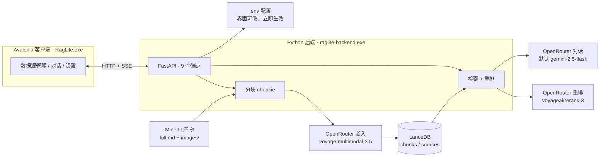

# rag-lite

本机自用的简易 RAG：把手动用 **MinerU** 解析出来的文档变成可检索的知识库，再让大模型**流式**回答。
后端 Python（FastAPI + LanceDB），界面 Avalonia（Windows 桌面），可以打成一个便携 zip——目标机器不用装 Python 和 .NET。

```
MinerU 手动解析产物  →  分块  →  向量化  →  LanceDB  →  检索  →  重排  →  流式问答
   full.md + images/      chonkie   voyage-3.5   本地文件   余弦 top20  rerank-3  任意 OpenAI 兼容
```

## 为什么这么设计

- **文本解析不自己做**：PDF/扫描件的解析交给 MinerU 客户端人工跑一次，程序只消费它的 `full.md` 与 `images/`，链路短、结果可控。
- **嵌入与重排都走云端 API**：本机不装模型、不吃显卡；回答模型可换成任意 OpenAI 兼容端点。
- **向量库用 LanceDB**：文件型数据库，跟着目录走，便携包里拷走就能用。
- **不做向量索引**：几百到几千块规模下暴力检索又快又准（官方文档口径也是几十万向量以内不必建索引）。
- **界面与后端分进程**：界面负责交互，后端负责干活；后端端口会被占用自动顺延，靠 stdout 的 `RAGLITE_READY {...}` 握手行告知实际端口。

## 架构



## 快速开始

### 方式一：便携包（日常使用）

```powershell
powershell -File zip\package.ps1        # 产出 release\rag-lite-<版本>.zip
```

解压后双击 `RagLite.exe` → 右上角「**设置**」粘进 OpenRouter 密钥 → 保存即生效 →
左侧「**批量添加目录…**」可以**一次选多个** MinerU 产物目录（同时最多导入 3 个，其余排队）→ 右下提问。
细节见包内的 `使用说明.txt`。

### 方式二：源码运行（开发）

```bash
# 后端：需要 uv（会自己准备 Python 3.14）
cd backend
uv sync
cp .env.example .env      # 填 OPENROUTER_API_KEY（或在界面设置里填）
uv run python main.py     # 起服务，stdout 打印 RAGLITE_READY {...}

# 前端：需要 .NET 10 SDK
cd frontend
dotnet run                # 会自动拉起上面的后端
```

### 测试

```bash
cd backend && uv run pytest -q     # 130 passed；只有 3 条会真调接口，其余用假实现
```

## 配置

值存在 `backend/.env`（便携版在 `<便携根>/.env`），**也可以在界面右上角「设置」里改**——写的是同一个文件，保存后立即生效、无需重启。
优先级：命令行参数 > 环境变量 > `.env` > 代码默认值。

| 用途 | 接入点 | 模型 | 密钥 | 其它 |
| --- | --- | --- | --- | --- |
| 嵌入 | `EMBED_BASE_URL` | `EMBED_MODEL` | `EMBED_API_KEY` | `EMBED_DIM`（256/512/1024/2048） |
| 重排 | `RERANK_BASE_URL` | `RERANK_MODEL` | `RERANK_API_KEY` | – |
| 回答 | `CHAT_BASE_URL` | `CHAT_MODEL` | `CHAT_API_KEY` | – |
| 共享兜底 | `OPENROUTER_API_KEY`（三个角色没单独配时都用它） | | | |
| 检索 | – | – | – | `RETRIEVE_TOP_K`(20) / `CONTEXT_N`(3) |
| 导入并发 | – | – | – | `MAX_PARALLEL_IMPORTS`(3)：同时导入几个目录，超出的排队；改完**重启**生效 |
| 服务 | – | – | – | `RAGLITE_HOST` / `RAGLITE_PORT`(17650) / `RAGLITE_DB_URI` |

⚠ **换嵌入模型**：维度写进了向量库结构。只换模型（维度不变）→ 重新导入原目录即可，程序会发现「入库时的模型」与当前配置不同而自动重新向量化；维度也变了 → 必须重建库（删 `data/lancedb` 或指向新目录），忘了这步启动时会直接报错并告诉你怎么办。

## 实测数据（2026-10，本机）

| 项目 | 数值 |
| --- | --- |
| 建库：387 块（引用 7 张图） | ≈ $0.015，约 51 秒（两篇文档） |
| 同一目录重复导入 | $0（内容哈希 + 嵌入模型都没变就跳过）；正在导入时重复添加直接 409 |
| 批量导入提速 | 3 篇真实文档（192+195+19 块）并发 **25.6s**；串行按同样口径约 52s（≈2×，上限是最慢那篇的耗时） |
| 一次检索 + 重排（20 篇候选） | ≈ $0.0006 |
| 一轮回答（3 条片段） | ≈ $0.0007 |
| 检索质量 | 5 个真实问题：用余弦召回 + `rerank-3` 后全部命中正确章节 |
| 便携包 | zip 202.2MB / 解包 536MB（`RagLite.exe` 单文件 138MB + 后端 386MB） |
| 启动 | 双击到「后端就绪」约 1.8s |

## 目录结构

```
backend/          Python 后端
  app/core/       分块 / 云端调用 / 向量库 / 导入 / 问答 五块
  app/api/        FastAPI 端点与后台任务
  tests/          测试 + 可人工复查的报告生成器（out/ 被 git 忽略）
frontend/         Avalonia 客户端
  Services/       后端进程管理（含握手）、HTTP/SSE 客户端、文件日志
  ViewModels/     数据源、对话、设置
  Views/          MainWindow / SettingsWindow
zip/              打包脚本与给最终用户的说明
计划.md           完整实施计划、决策依据与踩坑记录
```

## 文档

| 文件 | 内容 |
| --- | --- |
| [`计划.md`](计划.md) | 实施计划：架构决策（含被否决的方案与理由）、接口实测结果、里程碑与验收、风险表 |
| [`backend/README.md`](backend/README.md) | 后端起步、接口表、配置细节、打包说明 |
| [`zip/使用说明.txt`](zip/使用说明.txt) | 打包进便携包、给最终用户看的说明 |
| `AGENTS.md` | 本仓库的协作约定（小步提交、中文注释等） |

## 已知限制

- **解析要手动**：文本解析在 MinerU 客户端完成，程序只吃它的产物目录（必须有 `full.md`）。
- **单会话**：对话上下文由后端一个会话持有（历史默认每轮全带），`清空上下文` 即清空。
- **导入并发有上限**：同时最多导入 `MAX_PARALLEL_IMPORTS`（默认 3）个目录，多的排队；同一个目录不会并发导入两次（会 409）；导入任务在内存里，后端重启就没了，也不支持取消。
- **没有全文检索**：只做向量召回 + 重排（中文分词在 LanceDB 的 FTS 上需要额外配置，收益存疑）。
- **界面被硬杀时后端会残留**：正常关窗会连带结束后端（已实测），但从任务管理器强杀时后端子进程可能变成孤儿，占着端口与文件（看门狗还没做）。
- **Markdown 渲染依赖预发布版**：`Markdown.Avalonia` 稳定版 11.0.3 是按 Avalonia 11 编译的，在 Avalonia 12 下启动即崩，因此固定用 `12.0.0-a3`。

## 技术栈

Python 3.14 · uv · FastAPI · LanceDB · chonkie · openai SDK · Avalonia 12.1.4 (.NET 10) · CommunityToolkit.Mvvm · Markdown.Avalonia 12.0.0-a3 · PyInstaller 6.22
