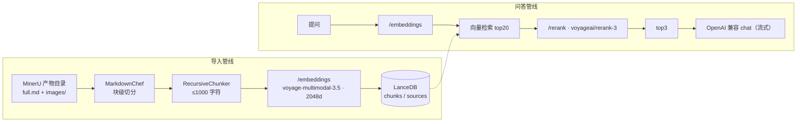

# rag-lite 实施计划（展开版）

## 当前进度（2026-10-16）

- 后端全链路已跑通并实测：**MinerU 产物 → 分块 → 向量化 → LanceDB → 检索 → 重排 → 流式问答 → HTTP 接口**。
- 前端（M4）与打包（M5）尚未开始。
- 库内现状：`backend/data/lancedb`，**387 块 / 2 个数据源 / 3.4MB**（`D:\MinerU Outputs` 下的 part1.pdf、part2.pdf）。
- 测试：`cd backend && uv run pytest -q` → **96 passed**（外部调用只有 3 条真打接口，其余全部用假实现）。
- 实测单位成本：全量导入 387 块 ≈ **$0.015**（幂等命中重复导入为 $0）；一次「检索+重排」≈ **$0.0006**；一轮回答（gemini-2.5-flash，含 3 条片段）≈ **$0.0007**。
- 可复查的产物（`backend/tests/out/`，已被 git 忽略）：分块报告、向量自检、跨文档检索、余弦 vs 重排对照、真实多轮对话记录。

## 怎么跑

```bash
cd backend && uv sync                 # 装依赖（需要 uv）
cp .env.example .env                  # 填 OPENROUTER_API_KEY
uv run python main.py                 # 起后端，stdout 会打印 RAGLITE_READY {...}
uv run pytest -q                      # 跑测试
uv run python tests/ingest_report.py  # 端到端：导入 + 跨文档检索
uv run python tests/chat_report.py    # 端到端：真实多轮对话
```


> 面向本项目唯一开发者；每一步都可直接执行。实测结论标注来源，未验证的推断标 `[推断]`。

## 0. 不变式（原始需求，不随实现变化）

- 自用、单机、Win11；界面 Avalonia；向量库 LanceDB；交付形态为便携压缩包。
- 文本解析在 MinerU 客户端人工完成；程序只消费产物目录：`full.md`（分块对象）+ `images/`。
- 分块用 Chonkie；嵌入 `voyageai/voyage-multimodal-3.5`、重排 `voyageai/rerank-3`，两者均经 OpenRouter。
- 回答模型：任意 OpenAI Compatible 端点。
- 前端两项功能：① 添加文件/目录作数据源 → 一键分块并嵌入 → 入库；② 对话提问 → 检索 → 重排 → 前 3 段作上下文交给大模型。

## 1. 现状盘点（仓库实测）

| 路径 | 现状 | 影响 |
| --- | --- | --- |
| `backend/pyproject.toml` | `requires-python >=3.14`；依赖 chonkie / lancedb / openai / requests，本机已装 1.7.0 / 0.40.0 / 3.31.0 / 2.34.2（Python 3.14.7，uv 0.12.13） | 依赖选型已够用，无需新增 |
| `backend/.python-version` | `3.14` | 与 `.venv` 一致 |
| `backend/main.py`、`app/config.py`、`app/api/__init__.py`、`app/core/__init__.py` | 全部 0 字节 | 无任何实现 |
| `backend/data/lancedb/` | 空目录 | `.gitignore` 已忽略 |
| `frontend/` | Avalonia **12.1.4** 模板原样（net10.0、CommunityToolkit.Mvvm 8.4.2、**Markdown.Avalonia 11.0.3**）；`MainWindow` 只有一个绑 `Greeting` 的 TextBox | 只做过 restore（`obj/` 有 nuget 产物，`bin/Debug/net10.0` 为空） |
| `frontend/Models/`、`frontend/Services/` | 空目录（csproj 已 `<Folder Include="Models\" />`） | 目录已预留 |
| `build/build_backend.py`、`build/package.ps1` | 0 字节占位 | 打包流程已预留 |
| `.gitignore` | 已分 5 段写好（密钥 / Python / LanceDB 数据 / .NET+打包产物 / OS） | 直接复用 |
| git | **无任何提交** | M0 先落基线提交 |

### 1.1 现状中已存在的 3 个坏点（M0 必修）

1. **后端入口是死的**：`[project.scripts] backend = "backend:main"` 生成的 `backend.exe` 指向不存在的模块——`uv_build` 写入的 `backend.pth` 内容是 `...\backend\src`（该目录不存在），实测 `import app` → `ModuleNotFoundError: No module named 'app'`，`import backend` 只能因 cwd 同名目录被当成命名空间包（`__file__ is None`）。
2. **打包脚本被 git 忽略**：`.gitignore:27` 的 `build/` 规则命中 `build/build_backend.py` 与 `build/package.ps1`，实测 `git check-ignore -v` 两者均被忽略。
3. **前端仍是模板**：窗口标题 `frontend`，`MainViewModel.Greeting`。

## 2. 架构决策

### D1 进程模型与 IPC：前端拉起后端子进程，走 `127.0.0.1` HTTP

`RagLite.exe` 启动时以子进程方式运行 `backend/raglite-backend.exe`，后端监听环回地址并**在 stdout 打印一行握手**（`RAGLITE_READY {"port":17650}`），前端读到后开始调用。

- 备选 stdio + 换行 JSON：无端口、无防火墙顾虑，但需自造请求/响应/进度/流式四套帧协议，且 chonkie/lancedb 任何写 stdout 的库都会污染信道；调试只能用自写客户端。
- 选 HTTP 的理由：可用 `curl` 直接验证（本计划的每条验收都靠它）、SSE 天然支持 LLM 流式与进度、`app/api` 包名本就指向这一层。
- 代价：需加 `fastapi` + `uvicorn` 两个依赖；端口冲突用“默认 17650，占用则向后探测 ≤17700，实际端口由握手行告知”解决。

### D2 云端调用：统一 `requests` 直连 REST，端点/模型/密钥全部可配

| 用途 | 端点 | 依据 |
| --- | --- | --- |
| 嵌入 | `POST https://openrouter.ai/api/v1/embeddings` | OpenRouter 文档（OpenAI 兼容；返回 `data[].embedding`；支持 `dimensions`、`encoding_format`、含 `image_url` 的 `content` 数组） |
| 重排 | `POST https://openrouter.ai/api/v1/rerank` | OpenRouter 文档（body: `model` / `query` / `documents` / `top_n`；返回 `results[].index/relevance_score`） |
| 回答 | `openai` SDK，`base_url` 覆盖 | 依赖里已有 `openai`，且需 SSE 流式 |

原始计划写的是“用 OpenRouter 官方 Python SDK”。官方 TS SDK（`@openrouter/sdk`）确认存在，Python 版文档入口存在但未能验证到具体包名与嵌入/重排覆盖度，因此**统一用 `requests` 直连**：零新依赖、协议即文档。想去掉这个偏离时，改动只集中在 `app/core/openrouter.py` 一个文件。

Voyage 官方 `voyageai` SDK 不走这条路——它直连 Voyage 而非 OpenRouter，且未安装。

### D3 分块：`MarkdownChef` 块级切分 + `RecursiveChunker` 尺寸收敛

实测 `chonkie.MarkdownChef(tokenizer="character").process(path) -> MarkdownDocument`，其 `.chunks` 是按标题/表格/代码/图片边界切好的块，`.tables`/`.code`/`.images` 带原文字符区间（`start_index`/`end_index`）。

流程：用表格/代码区间把 `doc.chunks` 分类 → 正文块交给 `RecursiveChunker(chunk_size=1000)` 收敛到 ≤1000 字符 → 表格/代码块整体保留（> 2000 字符时才按行切）→ `doc.images` 按区间归入覆盖它的块，成为该块的附图。

### D4 存储：单库两表，2048 维、cosine

`backend/data/lancedb`，表 `chunks`（向量 + 文本 + 溯源）与 `sources`（数据源登记与幂等指纹）。维度**默认 2048 且可配置**（`EMBED_DIM`；该模型支持 256/512/1024/2048）：它写进 LanceDB 的定长向量列，所以换维度必须重建库——`Store` 会比对已有 schema 的维度并给出明确提示，避免两种维度混进一张表。检索用 `table.search(v).metric("cosine").limit(k)`（实测 `LanceVectorQueryBuilder.metric` 存在，且实测向量 L2 范数 ≈ 1.0，余弦与点积等价）。

### D5 检索：向量 top20 → rerank → 取 3

不做 FTS 混合检索：LanceDB FTS 基于 Tantivy，中文分词需额外配置，收益存疑；rerank 已能显著改善顺序。列为 M6 可选。

### D6 幂等：以 `full.md` 的 sha256 为准

同源码文件哈希未变则跳过（返回 `skipped`）；变则删旧行重灌。

### D7 打包：PyInstaller onedir + `dotnet publish` self-contained

PyInstaller **≥ 6.15.0**（该版本起支持 Python 3.14，本项目解释器 3.14.7）；前端 `win-x64` self-contained。**不启用 `PublishTrimmed`**：`ViewLocator` 用 `Type.GetType` 反射（源码里已标 `[RequiresUnreferencedCode]`），裁剪会破坏视图解析。



## 3. 目标文件结构

```
backend/
  main.py                     # ✅ 入口：argparse → 选空闲端口 → uvicorn.run → stdout 握手行
  .env / .env.example         # 本机密钥（.env 被 git 忽略）
  help/                       # 最小调用示例：embed-demo.py / rerank-demo.py（从 .env 读 key）
  app/
    config.py                 # ✅ Settings + load_settings（CLI > 环境变量 > .env > 默认）
    api/
      server.py               # ✅ create_app(settings, store?, on_startup?) -> FastAPI
      models.py               # ✅ 请求/响应 Pydantic 模型（与 frontend/Models 对齐）
      jobs.py                 # ✅ Job 登记表（单任务串行 + 进度回调）
      routes.py               # ✅ 7 个端点：health / sources / jobs / chat(SSE) / chat/clear
    core/
      chunking.py             # ✅ Block + chunk_markdown()
      openrouter.py           # ✅ 嵌入 + 重排：read_api_key / embed_texts / embed_blocks / rerank（chat_stream 待做）
      schema.py               # ✅ chunks / sources 的 pyarrow schema + 行构造
      store.py                # ✅ Store：建表、写入、余弦检索、删除、upsert
      ingest.py               # ✅ 导入管线（分块→向量化→入库，按 full.md 哈希幂等）
      query.py                # ✅ 问答管线（检索→重排→流式回答；历史全带 + clear()）
    data/lancedb/             # 运行期生成（git 忽略）；当前 387 块 / 2 数据源 / 3.4MB
  tests/
    test_chunking.py          # ✅ 分块回归测试（14 条，含真实语料不变量）
    test_openrouter.py        # ✅ 向量化 + 重排回归测试（29 条，假 HTTP 会话 + 2 条真调用）
    test_store.py             # ✅ LanceDB 读写测试（14 条，真实库 + 手写向量，不联网）
    test_ingest.py            # ✅ 导入管线测试（11 条，只把嵌入调用换成假的）
    test_query.py             # ✅ 问答管线测试（12 条，外部调用全假）
    test_api.py               # ✅ HTTP 接口测试（15 条，TestClient + 真实临时库）
    chunking_report.py        # ✅ 分块检查报告生成器
    embedding_report.py       # ✅ 向量化报告生成器（含相似度自检）
    ingest_report.py          # ✅ 导入 + 跨文档检索报告生成器
    rerank_report.py          # ✅ 余弦 vs 重排对照报告生成器
    chat_report.py            # ✅ 真实多轮对话记录生成器
    out/                      # 报告与向量产物（git 忽略）
frontend/
  Models/                     # DTO：HealthDto / SourceDto / JobDto / ChatEvent / ChatMessage
  Services/
    BackendProcess.cs         # 拉起/握手/退出清理子进程
    ApiClient.cs              # HttpClient + JSON source-gen + SSE 解析
  ViewModels/
    MainViewModel.cs          # 左：数据源 + 导入进度；右：对话
    MessageViewModel.cs       # 单条消息（Role/Content/IsStreaming/Sources）
  Views/MainWindow.axaml      # 两栏布局（260px + *）
zip/
  build_backend.py            # PyInstaller onedir（待做）
  package.ps1                 # publish + 组装 + 压缩（待做）
```

## 4. 后端设计

### 4.1 `app/config.py`　✅ 已实现

```python
@dataclass(frozen=True, slots=True)
class Settings:
    # 嵌入：dim 写进库 schema，改了要重建库
    embed_base_url: str; embed_model: str; embed_dim: int; embed_api_key: str
    # 重排
    rerank_base_url: str; rerank_model: str; rerank_api_key: str
    # 回答（任意 OpenAI Compatible）
    chat_base_url: str; chat_model: str; chat_api_key: str
    api_key: str                    # 共享兜底密钥（OPENROUTER_API_KEY）
    retrieve_top_k: int; context_n: int
    root: Path; data_dir: Path; db_uri: str; host: str; port: int

    embed_key / rerank_key / chat_key   # 各自配了就用各自的，否则回落 api_key
    missing_keys / configured           # 哪个角色还没配到密钥

load_settings(*, root=None, env_file=None, **overrides) -> Settings   # 命令行 > 环境变量 > .env > 默认
```

- 字段 → 环境变量名集中在文件顶部的 `ENV_NAMES` 表里，加配置项只需加一行；
- 换嵌入模型时必须同时改 `EMBED_DIM`（并重建库）——`Store` 会拿现有 schema 里的维度做比对，
  不一致直接给出「现在几维 / 配置几维 / 删库重导还是改回配置」的提示；
- 只换模型不改维度也**不能**沿用旧向量：`ingest` 的跳过条件从「内容哈希相同」升级为
  「内容哈希 + 嵌入模型 + 维度 三者都相同」，否则重新向量化；`/api/sources` 会给旧模型入库的行打 `stale` 标记，
  `/api/health` 汇总 `sources_stale`，前端据此提示「需重新导入」。

### 4.2 `app/core/schema.py`

```python
CHUNKS_SCHEMA = pa.schema([
    ("chunk_id", pa.string()), ("source_id", pa.string()),
    ("vector", pa.list_(pa.float32(), EMBED_DIM)),
    ("text", pa.string()), ("rel_path", pa.string()), ("kind", pa.string()),
    ("heading", pa.string()), ("start", pa.int32()), ("end", pa.int32()),
    ("token_count", pa.int32()), ("n_images", pa.int32()),
])
SOURCES_SCHEMA = pa.schema([
    ("source_id", pa.string()), ("name", pa.string()), ("path", pa.string()),
    ("file_sha256", pa.string()), ("chunk_count", pa.int32()),
    ("embed_model", pa.string()), ("added_at", pa.string()), ("embedded_at", pa.string()),
])
```

`vector` 定长必须等于 `settings.embed_dim`；`Store.__init__` 遇已有库时校验恒等，不等直接抛错（避免静默混维）。

### 4.3 `app/core/chunking.py`

```python
@dataclass
class Block:
    text: str
    kind: str                 # "text" | "table" | "code"
    images: list[Path]        # 块内引用的本地图片（绝对路径）
    start: int; end: int; token_count: int; heading: str

def chunk_markdown(full_md: Path, *, chunk_size: int,
                   max_images_per_chunk: int) -> tuple[list[Block], str]  # (blocks, sha256)
```

图片解析：`MarkdownChef.extract_images` 给出的 `content` 是 markdown 里的原始 src（如 `images/x.jpg`），相对 `full.md` 所在目录解析；不存在的文件跳过并计入警告。

### 4.4 `app/core/openrouter.py`　✅ 嵌入 + 重排 + 流式对话已实现

```python
def read_api_key(*, env_file=DEFAULT_ENV_FILE) -> str              # 环境变量 → backend/.env
def embed_texts(texts, *, api_key, model=…, dim=2048, batch=16, input_type="search_document",
                timeout_s=120, max_retries=4, session=None, sleep=time.sleep,
                on_progress=None) -> EmbedResult
def embed_blocks(blocks, *, …同上…) -> EmbedResult                  # 顺序与 blocks 一致
def rerank(query, documents, *, api_key, model="voyageai/rerank-3", top_n=None,
           truncate_chars=4000, …) -> RerankResult                 # order/scores 是原文档下标，已降序
class ChatStream:  # 流式对话：send(messages) 逐段产出文本，.usage 读用量
```

嵌入与重排共用同一个 `_Client`（重试、退避、错误包装只有一份实现）。已实测的接口要点：

| 要点 | 实测结果 |
| --- | --- |
| 嵌入端点/模型 | `POST …/embeddings`，`voyageai/voyage-multimodal-3.5` |
| 维度 | `dimensions` 支持 256/512/1024/2048，本项目用 **2048**；返回定长 2048，需校验 |
| 批处理 | `input` 可放多条；本模块 16 条/批，且单批字符数 ≤32000 |
| 图文混排 | 有图块 `input` 元素为 `{"content":[{"type":"text",…},{"type":"image_url","image_url":{"url":"data:image/jpeg;base64,…"}}]}`；**本地图片必须内联成 data URI**，接口不收本地路径 |
| 嵌入计费 | 响应 `usage` 直接给 `prompt_tokens` / `cost`；图片按 `usage.prompt_tokens_details.image_tokens` 计（实测一张校徽图 135 image tokens） |
| input_type | `search_document` / `search_query` 均被接受；入库用前者、查询用后者 |
| 重排端点/模型 | `POST …/rerank`，`voyageai/rerank-3`；body = `{model, query, documents, top_n?}` |
| 重排文档格式 | 纯文本直接传字符串数组即可（接口也接受 `{"text": …}` 对象）；重排是纯文本模型，**不传图** |
| 重排返回 | `results[].{index, relevance_score}`，`index` 对应原文档下标；模块内再按分数降序排一次保险，并校验下标不越界、不重复 |
| 重排计费 | `usage.total_tokens`（实测 20 篇文档约 5–9K token ≈ $0.0003/问）；上游没回 `cost` 时按 $0.05/M token 估算 |
| 截断 | 单篇文档截断到 4000 字符（模型上限是「查询+文档」32K token，单块最长约 1400 字符，余量足够） |
| 稳定性 | 429/5xx/网络错误按 1→2→4…s 退避重试（≤4 次，尊重 `Retry-After`）；400 之类参数错立即失败；200 响应里带 `error` 也当失败 |

坑：一次嵌入请求里混着「纯文本条目」和「图文条目」容易被上游挑刺，所以两类分开——纯文本按批发，带图的块一条一个请求（本语料只有 7 张图，代价可忽略）。

`rerank` 的文档按纯字符串提交（实测即可），截断到 4000 字符。待做的 `chat_stream` 走 `openai` SDK 覆盖 `base_url`，system 提示词固定为「只依据给定片段回答，无依据则明说；引用时标注 `[来源 n]`」。

### 4.5 `app/core/store.py`

```python
class Store:
    def __init__(self, db_uri: str, dim: int)              # 建表或校验已有表
    def sources(self) -> list[dict]
    def upsert_source(self, row: dict) -> None             # merge_insert(on="source_id")
    def delete_source(self, source_id: str, *, purge: bool) -> None
    def add_chunks(self, rows: list[dict]) -> int          # table.add(...)
    def drop_source_chunks(self, source_id: str) -> None   # table.delete(f"source_id = '{sid}'")
    def search(self, vector: list[float], top_k: int) -> list[dict]
    def stats(self) -> tuple[int, int]                     # (chunks, sources)
```

`search` 返回 `chunk_id / source_id / rel_path / text / heading / _distance`；`source_id` 经 `sources` 表翻译成人类可读名字后再给前端。

建表与度量（已对官方文档核对，2026-10）：
- 建表：`db.create_table("chunks", schema=arrow_schema, exist_ok=True)` —— `exist_ok=True` 是「幂等打开」：表已存在就复用且**校验 schema**，不一致直接报错（维度从 2048 改成别的会被立刻发现，而不是悄悄混维度）。
- 距离度量：`.metric("cosine")`。文档原话是「`cosine` 用于未归一化向量，`dot` 用于已归一化向量（性能最好）」，我们实测向量范数 ≈1.0，两者等价，取 `cosine` 以保证换模型后仍然正确；**不建向量索引**——文档明确写「暴力检索适合几十万向量以内」，且 ANN 会牺牲召回率；超过几十万向量再考虑 `IVF_PQ` + 与索引一致的度量。
- upsert：`table.merge_insert("source_id").when_matched_update_all().when_not_matched_insert_all().execute([row])`。文档提醒 `merge_insert` 的 join 列在未建标量索引、未索引行数 > 10000 时会报 400；本项目规模远低于此，暂不建标量索引。
- 删除：`table.delete("source_id = '...'")`。文档说明主键只是元数据、不保证唯一，所以重导入前必须先删旧行。

### 4.6 `app/core/ingest.py`　✅ 已实现

```python
def ingest(source_dir, store, *, api_key, model=…, dim=2048, batch=16,
           force=False, on_progress=None) -> IngestResult      # 分块→向量化→入库，按 full.md 哈希幂等
def remove_source(path_or_id, store) -> None                    # 删登记 + 删全部分块
```

步骤：校验 `full.md` 存在 → `chunk_markdown` 得 blocks + sha256 → 库里同源且哈希相同则 `skipped=True` 直接返回（不调接口、不写库）→ 有旧数据先 `drop_source_chunks` → `embed_blocks`（回调 `on_progress(done, total, "向量化")`）→ `add_chunks` → `upsert_source`。
并发：当前由调用方保证串行（`ingest_report.py` 逐源跑）；将来 HTTP 层用「全局单任务」挡住并发写（失败返回 409）。

### 4.7 `app/core/query.py`　✅ 已实现

```python
@dataclass ChatConfig: model / base_url / api_key         # 任意 OpenAI Compatible 端点
def load_chat_config(*, env_file=None) -> ChatConfig       # CHAT_MODEL / CHAT_BASE_URL / CHAT_API_KEY，缺省复用 OpenRouter 密钥

class ChatSession:
    history: list[dict]                                    # 原始问答对，按时间顺序
    turns -> int
    def clear(self) -> int                                 # 清空上下文，返回被清掉的条数
    def retrieve(question, *, api_key=None) -> list[Source] # 余弦 top20 → rerank-3 → 前 3
    def ask(question) -> Iterator[RetrievalEvent | TokenEvent | DoneEvent]

def build_messages(question, sources, history, *, system_prompt=SYSTEM_PROMPT) -> list[dict]
def format_context(sources) -> str                          # 「[来源 n] 名称 · 面包屑 + 正文」
```

**对话历史策略（按需求）**：
- 每次提问默认把**全部历史**按顺序放进 messages，再在最后一条 user 消息里附上本轮参考片段；
- 历史里只存**用户原始问题 + 助手回答**，参考片段不进历史——片段每轮重新检索，历史不会随轮数膨胀；
- `clear()` 清空上下文，HTTP 层对应 `POST /api/chat/clear`；追问式问题（如「那学业奖学金呢」）靠历史才能正确解析；
- 回答流式产出：`RetrievalEvent` → 若干 `TokenEvent` → `DoneEvent`（含完整回答与用量）；调用方中途取消时**不写入半截历史**。

### 4.7 `app/api/`

`server.py: create_app(settings) -> FastAPI`，挂载三个 router，注册 CORS 不必要（同机前端直接 HTTP 客户端调用）。`models.py` 用 Pydantic 定义下面第 5 节的 DTO。任务表用进程内 `dict[str, Job]` + `threading.Thread`（导入是阻塞 IO，线程足够）：

```python
@dataclass
class Job:
    id: str; kind: str; state: str        # running | done | failed
    total: int = 0; done: int = 0; message: str = ""; error: str = ""; result: dict | None = None
```

### 4.8 `app/api/` + `backend/main.py`　✅ 已实现

```python
# config.py
load_settings(*, root=None, env_file=None, **overrides) -> Settings   # CLI > 环境变量 > .env > 默认

# api/server.py
create_app(*, settings, store=None, on_startup=None) -> FastAPI        # store 可注入（测试用临时库）

# api/jobs.py
class JobRegistry: start(kind, work) / get(job_id) / progress(job)     # 单任务串行，BusyError → 409
```

- 对话会话挂在 `app.state.chat`，**首次提问时才创建**（没配密钥也能正常启动，`/api/health` 会如实报 `configured=false`）；
- SSE 用 `StreamingResponse`（同步生成器）手写 `data: {...}\n\n`，不额外引入 sse-starlette；出错也发一个 `error` 帧，前端不会只看到断流；
- 客户端断开时 Starlette 停止迭代 → `ChatSession.ask` 被关闭 → 半截回答不写进历史（已有测试覆盖）。

### 4.9 `backend/main.py`　✅ 已实现

```python
def free_port(host, start, tries=50) -> int    # 从 start 往后找可绑定的端口
def main(argv=None) -> int                     # --host/--port/--data-dir/--log-level
```

端口先由 `free_port()` 定好（被占就顺延，`--port 0` = 自动挑），**握手行在 lifespan 启动回调里打印**——
也就是端口真正绑定成功之后，前端读到 `RAGLITE_READY {"host":..., "port":...}` 再发请求，不会抢跑。

## 5. HTTP 契约

| 方法 | 路径 | 请求体 | 响应 | 备注 |
| --- | --- | --- | --- | --- |
| GET | `/api/health` | – | `{"status":"ok","chunks":N,"sources":M,"configured":true,"embed_dim":2048}` | `configured=false` 表示缺 API Key |
| GET | `/api/sources` | – | `[SourceDto]` | 含 `missing`（`full.md` 已不存在） |
| POST | `/api/sources` | `{"path":"D:/.../out","name":"可选"}` | `202 {"job_id":"..."}` | 校验失败 400；已有任务 409 |
| DELETE | `/api/sources/{id}?purge=true` | – | `204` | `purge=false` 只删登记 |
| GET | `/api/jobs/{id}` | – | `JobDto` | 前端 500ms 轮询 |
| POST | `/api/chat` | `{"question":"..."}` | `text/event-stream` | SSE 事件见下；**历史由后端会话持有**，不必每次上传 |
| POST | `/api/chat/clear` | – | `204` | 清空对话上下文（对应 `ChatSession.clear()`） |

`SourceDto = {source_id, name, path, chunk_count, added_at, embedded_at, missing}`；`JobDto = {id, kind, state, total, done, message, error, result}`。

SSE 帧（每帧 `data: {json}\n\n`）：

```
{"type":"sources","items":[{"name":"paperA","rel_path":"full.md","heading":"2.1","score":0.83,"preview":"前 120 字…"}]}
{"type":"token","text":"根"}
{"type":"done","usage":{"prompt_tokens":1234,"completion_tokens":210}}
{"type":"error","message":"..."}
```

`done`/`error` 后服务端关闭流；客户端断开（取消）时停掉上游 `chat_stream` 迭代。

## 6. 前端设计

### 6.1 Services

- `BackendProcess.cs`：`StartAsync()` 解析后端可执行文件路径——Release 下 `<root>/backend/raglite-backend.exe`，Debug 下回退 `backend/.venv/Scripts/python.exe backend/main.py`（开发期免打包）；异步读 stdout 直到匹配 `RAGLITE_READY {json}`（超时 60s 抛错），暴露 `BaseAddress`；`DisposeAsync` 先 `POST /api/shutdown` 再 `Kill(entireProcessTree: true)` 兜底。
- `ApiClient.cs`：单个 `HttpClient { BaseAddress = ... , Timeout = Timeout.InfiniteTimeSpan }`；`JsonSerializerContext` source-gen（避免反射序列化）；`StreamChatAsync` 用 `HttpCompletionOption.ResponseHeadersRead` + `StreamReader.ReadLineAsync`，遇到 `data: ` 前缀解析成 `ChatEvent`，`yield return`。

### 6.2 ViewModels / Views

`MainViewModel`（`CommunityToolkit.Mvvm` `[ObservableProperty]` / `[RelayCommand]`）：

- 数据源区：`ObservableCollection<SourceItemVm> Sources`；`AddSourceCommand` → `StorageProvider.OpenFolderPickerAsync`（`MainWindow` 注入 `TopLevel`）→ `POST /api/sources` → 轮询 `GET /api/jobs/{id}` 更新该行进度；`RemoveSourceCommand` → `DELETE ?purge=true`。
- 对话区：`ObservableCollection<MessageViewModel> Messages`；`SendCommand` 追加用户消息与一条空的助手消息，边收 `token` 边 `Append`；`sources` 事件写进助手消息的 `Sources`（`[来源 1] paperA · 2.1 · 0.83`）。
- `MarkdownScrollViewer`（Markdown.Avalonia 11.0.3 实测导出的控件）渲染助手消息；流式时**按 80ms 节流**刷新 `Markdown` 属性，避免每 token 重建视觉树。
- 布局：`Grid ColumnDefinitions="260,*"`，左栏 `ListBox` + 底部按钮，右栏消息 `ItemsControl` + 底部 `TextBox` + 发送按钮；`TextBox` 回车发送（`KeyBindings`）。
- 启动失败（后端未起来/缺 Key）用右栏顶部常驻提示条展示 `health.configured` 与错误文案，不弹模态框。

## 7. 配置与密钥

配置来源与优先级：**命令行参数 > 环境变量 > `backend/.env` > 代码默认值**。
密钥只放 `backend/.env`（已被 `.gitignore` 忽略），模板见 `backend/.env.example`。

| 配置项 | 环境变量 | 默认值 | 说明 |
| --- | --- | --- | --- |
| 共享密钥 | `OPENROUTER_API_KEY` | 空 | 三个角色没单独配时都用它 |
| 嵌入接入点 | `EMBED_BASE_URL` | `https://openrouter.ai/api/v1` | 程序自动接 `/embeddings` |
| 嵌入模型 | `EMBED_MODEL` | `voyageai/voyage-multimodal-3.5` | |
| 嵌入维度 | `EMBED_DIM` | `2048` | 256/512/1024/2048；**写进库 schema，改了必须重建库** |
| 嵌入密钥 | `EMBED_API_KEY` | 空 | 可指向另一家服务 |
| 重排接入点 | `RERANK_BASE_URL` | `https://openrouter.ai/api/v1` | 自动接 `/rerank` |
| 重排模型 | `RERANK_MODEL` | `voyageai/rerank-3` | |
| 重排密钥 | `RERANK_API_KEY` | 空 | |
| 回答接入点 | `CHAT_BASE_URL` | `https://openrouter.ai/api/v1` | 任意 OpenAI Compatible 端点 |
| 回答模型 | `CHAT_MODEL` | `google/gemini-2.5-flash` | |
| 回答密钥 | `CHAT_API_KEY` | 空 | |
| 召回条数 | `RETRIEVE_TOP_K` | `20` | 余弦先捞多少条 |
| 上下文条数 | `CONTEXT_N` | `3` | 重排后送给大模型几条 |
| 监听地址/端口 | `RAGLITE_HOST` / `RAGLITE_PORT` | `127.0.0.1` / `17650` | 端口被占会自动顺延 |
| 库位置 | `RAGLITE_DB_URI` | `backend/data/lancedb` | 换模型重建库时直接指到新目录 |

- `/api/health` 会回传三个角色**当前实际在用**的接入点、模型、维度，以及 `missing_keys`、`sources_stale`，
  换配置后不必猜有没有生效；
- 打包**不含**任何密钥，只放 `.env.example`；
- 提醒：`backend/help/*.py` 里原本硬编码过真实 key，已改为从 `.env` 读取——提交前别把密钥写回代码。

## 8. 打包与分发

`build/build_backend.py`（PyInstaller onedir）：

```
pyinstaller --noconfirm --clean --onedir --name raglite-backend
  --paths backend
  --collect-all chonkie --collect-all chonkie_core
  --collect-all lancedb --collect-all lance_namespace
  --collect-submodules uvicorn
  --distpath build_backend/dist --workpath build_backend/work --specpath build_backend
  backend/main.py
```

`build/package.ps1`：

```
uv run --project backend python build/build_backend.py
dotnet publish frontend/frontend.csproj -c Release -r win-x64 --self-contained true `
  -p:PublishTrimmed=false -o publish/frontend
# 组装 release/rag-lite-<ver>/ 并 Compress-Archive
```

压缩包布局：

```
rag-lite/
  RagLite.exe  +  前端运行时 dll
  backend/raglite-backend.exe  +  backend/_internal/**
  data/                      # 首次运行创建 lancedb/
  config.local.json.example
  使用说明.txt
```

数据目录固定为 exe 同级 `data/`，因此换机整包拷贝即可用；源登记里存的是数据源的绝对路径，换机后会标灰（`missing`），需重新添加。

## 9. 里程碑与验收

| 里程碑 | 内容 | 验收（可执行） |
| --- | --- | --- |
| **M0 骨架修复** ✅ | 已删掉 `[build-system]` 与 `[project.scripts]`（uv 对无构建系统的项目不安装自身，实测官方行为；入口统一为 `python main.py`）；打包脚本目录已由用户从 `build/` 改名为 `zip/`，`.gitignore` 里 `build/` 的误伤随之消失 | `uv sync --project backend` 干净通过 |
| **M1 云端调用** ✅ | `app/core/openrouter.py`：`read_api_key` / `embed_texts` / `embed_blocks`；`app/core/config.py` 尚未建（当前参数走函数入参，够用；等 store/API 层需要时再抽 Settings）。重排、回答生成待做 | 已实测：两个真实数据源共 387 块 → 31 次调用、$0.0152、65s；向量 192/195 × 2048，L2 范数 ≈ 1.0，无 NaN；相似度自检命中正确章节（如「延期公开」→ 该办法 0.774） |
| **M2 导入管线** ✅ | `schema.py` + `store.py` + `ingest.py` 已落地；`/api/sources`、`/api/jobs` 属于 M4 前端所需的 HTTP 层，尚未开始 | 已实测：两个真实产物目录 → 387 块入库（`backend/data/lancedb`，3.4MB），`store.count_chunks()` 与分块数一致；紧接着重复导入 → `skipped=true` 且未再调接口；改动 `full.md` → 块数更新且**无新旧重块**（测试覆盖）；跨文档检索 5 问全部命中正确章节（见 `tests/out/retrieval.md`） |
| **M3 问答管线** ✅ | `query.py` + FastAPI 外壳全部落地：7 个端点、SSE 流式回答、历史默认全带、`/api/chat/clear` 清空 | 已实测（真起服务 + curl/requests）：`/api/health` → 387 块/2 源/`configured=true`/2048 维；`POST /api/sources` → 202 + job → 轮询到 `skipped=true`（**$0**，未重复向量化）；坏路径 400、未知 job/源 404；`POST /api/chat` 依次收到 `sources`(3 条，重排后命中该办法) → `token`×N → `done`（prompt 1393 / completion 101，$0.00067），答案列出五种处分并标注 `[来源 2, 来源 3]`；`/api/chat/clear` → `{cleared:2,turns:0}`，再问「我上一条问的是什么」模型答不知道 |
| **M4 前端** | 6.1/6.2 全部 | 手动跑通两条前端功能：选中目录 → 行内进度到 100% → 提问得流式回答（截图/录屏留证） |
| **M5 打包** | `build_backend.py` + `package.ps1` | 在**干净目录**解压 zip → 双击 `RagLite.exe` → 完成一次导入 + 一次问答；确认包内无密钥文件 |
| **M6 可选** | 中文混合检索（FTS）、会话落盘、设置界面、图片参与重排 | 各自单独立项 |

## 10. 风险与待定

| # | 风险 | 应对 |
| --- | --- | --- |
| R1 | PyInstaller 收集 `chonkie_core`（Rust 扩展）、`lance_namespace`、uvicorn 动态导入可能漏件 | 用 `--collect-all` / `--collect-submodules`；onedir（不用 onefile，省启动解包时间）；M5 在干净目录实测 |
| R2 | 首包体积 `[推断]` 120–200MB | 接受（自用便携包）；必要时砍 diagnostics/字体包 |
| R3 | voyage 输入上限 32K token/条；rerank 32K/对（query ≤8K） | 分块 ≤1000 字符 + 重排前截断 4000 字符，余量充足 |
| R4 | 费用：嵌入 $0.12/M 文本 token、$0.60/B 像素；rerank $0.05/M token | 幂等跳过 + 并发=1 + 单图 4MB 上限；导入前在任务里报预估块数 |
| R5 | 图片以 base64 data URI 入队使请求体膨胀（每图约 200KB） | 每块最多 4 图、单图 4MB 上限，超限跳过并计入 `warnings` |
| R6 | Markdown.Avalonia 流式渲染抖动 | 80ms 节流刷新 `Markdown` 属性；仍抖动则退化为纯文本追加、结束后一次性渲染 `[待实测]` |
| R7 | 向量索引：ANN 会牺牲召回率，且度量必须与索引一致 | 本项目规模（几百~几千块）不建索引，用暴力检索拿精确结果；超过几十万向量再上 `IVF_PQ`（官方文档口径） |

**待定（需你拍板，未拍板前按括号内默认执行）**：会话是否落盘（默认：内存，退出即失）；是否引入 FTS 混合检索（默认：不做）；默认 `chat_model`（默认 `google/gemini-2.5-flash`）；是否改用 OpenRouter 官方 Python SDK（默认：不用，REST）；图片是否参与嵌入（默认：参与，无图时自动退化为纯文本）。
