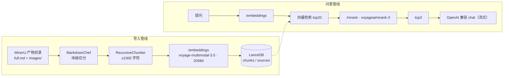

# rag-lite 实施计划（展开版）

## 当前进度（2026-10-20）

- 全链路已跑通并实测：**MinerU 产物 → 分块 → 向量化 → LanceDB → 检索 → 重排 → 流式问答 → HTTP 接口 → Avalonia 界面 → 便携包**。
- 界面可直接改后端配置（写 `backend/.env` 并热应用，密钥只回固定圆点，不显示明文或片段）。
- 便携包产物：`release/rag-lite-0.2.3.zip`（207.5MB；解包后 549.7MB，其中后端 387.3；前端已打成单文件 162.4MB）。
- 剩下的是你的人工验收：界面外观/交互手感，以及打包版在别的机器上的实跑。
- 库内现状：`backend/data/lancedb`，**387 块 / 2 个数据源 / 3.4MB**（`D:\MinerU Outputs` 下的 part1.pdf、part2.pdf）。
- 测试：`cd backend && uv run pytest -q` → **188 passed**（外部调用只有 3 条真打接口，其余全部用假实现）。
- 实测单位成本：全量导入 387 块 ≈ **$0.015**（幂等命中重复导入为 $0）；一次「检索+重排」≈ **$0.0006**；一轮回答（gemini-2.5-flash，含 3 条片段）≈ **$0.0007**。
- 可复查的产物（`backend/tests/out/`，已被 git 忽略）：分块报告、向量自检、跨文档检索、余弦 vs 重排对照、真实多轮对话记录。

## 怎么跑

```bash
cd backend && uv sync                 # 装依赖（需要 uv）
cp .env.example .env                  # 填 OPENROUTER_API_KEY
uv run python main.py                 # 起后端，stdout 会打印 RAGLITE_READY {...}
uv run pytest -q                      # 跑测试
uv run python tests/ingest_report.py  # 端到端：导入 + 跨文档检索
uv run python tests/chat_report.py    # 端到端：真实多轮对话
```


> 面向本项目唯一开发者；每一步都可直接执行。实测结论标注来源，未验证的推断标 `[推断]`。

## 0. 不变式（原始需求，不随实现变化）

- 自用、单机、Win11；界面 Avalonia；向量库 LanceDB；交付形态为便携压缩包。
- 文本解析在 MinerU 客户端人工完成；程序只消费产物目录：`full.md`（分块对象）+ `images/`。
- 分块用 Chonkie；嵌入 `voyageai/voyage-multimodal-3.5`、重排 `voyageai/rerank-3`，两者均经 OpenRouter。
- 回答模型：任意 OpenAI Compatible 端点。
- 前端两项功能：① 添加文件/目录作数据源 → 一键分块并嵌入 → 入库；② 对话提问 → 检索 → 重排 → 前 3 段作上下文交给大模型。

## 1. 现状盘点（仓库实测）

| 路径 | 现状 | 影响 |
| --- | --- | --- |
| `backend/pyproject.toml` | `requires-python >=3.14`；依赖 chonkie / lancedb / openai / requests，本机已装 1.7.0 / 0.40.0 / 3.31.0 / 2.34.2（Python 3.14.7，uv 0.12.13） | 依赖选型已够用，无需新增 |
| `backend/.python-version` | `3.14` | 与 `.venv` 一致 |
| `backend/main.py`、`app/config.py`、`app/api/__init__.py`、`app/core/__init__.py` | 全部 0 字节 | 无任何实现 |
| `backend/data/lancedb/` | 空目录 | `.gitignore` 已忽略 |
| `frontend/` | Avalonia **12.1.4** 模板原样（net10.0、CommunityToolkit.Mvvm 8.4.2、**Markdown.Avalonia 11.0.3**）；`MainWindow` 只有一个绑 `Greeting` 的 TextBox | 只做过 restore（`obj/` 有 nuget 产物，`bin/Debug/net10.0` 为空） |
| `frontend/Models/`、`frontend/Services/` | 空目录（csproj 已 `<Folder Include="Models\" />`） | 目录已预留 |
| `build/build_backend.py`、`build/package.ps1` | 0 字节占位 | 打包流程已预留 |
| `.gitignore` | 已分 5 段写好（密钥 / Python / LanceDB 数据 / .NET+打包产物 / OS） | 直接复用 |
| git | **无任何提交** | M0 先落基线提交 |

### 1.1 现状中已存在的 3 个坏点（M0 必修）

1. **后端入口是死的**：`[project.scripts] backend = "backend:main"` 生成的 `backend.exe` 指向不存在的模块——`uv_build` 写入的 `backend.pth` 内容是 `...\backend\src`（该目录不存在），实测 `import app` → `ModuleNotFoundError: No module named 'app'`，`import backend` 只能因 cwd 同名目录被当成命名空间包（`__file__ is None`）。
2. **打包脚本被 git 忽略**：`.gitignore:27` 的 `build/` 规则命中 `build/build_backend.py` 与 `build/package.ps1`，实测 `git check-ignore -v` 两者均被忽略。
3. **前端仍是模板**：窗口标题 `frontend`，`MainViewModel.Greeting`。

## 2. 架构决策

下面 19 条按编号顺序排列，每条记「选了什么 + 为什么 + 代价」；一句话索引：

> 维护约定：**新记录直接追加在末尾**（D15、D16…），**编号只增不改、不重排**——
> 正文与发布说明里都是按编号引用的（「见 D5」），重编号会让那些引用失效。

| 编号 | 一句话 |
| --- | --- |
| D1 | 进程模型与 IPC：前端拉起后端子进程，走 `127.0.0.1` HTTP |
| D2 | 云端调用：统一 `requests` 直连 REST，端点/模型/密钥全部可配 |
| D3 | 分块：`MarkdownChef` 块级切分 + `RecursiveChunker` 尺寸收敛 |
| D4 | 存储：单库两表，2048 维、cosine |
| D5 | 检索：向量 top20 → rerank → 取 3 |
| D6 | 幂等：以 `full.md` 的 sha256 为准 |
| D7 | 打包：PyInstaller onedir + `dotnet publish` self-contained |
| D8 | 并发导入：有界并发 + 排队 + 按源去重（不做 asyncio 重写） |
| D9 | 防孤儿进程：作业对象 + 后端看门狗（两道都上） |
| D10 | 图标：从 book.png 生成多尺寸 ICO |
| D11 | 托盘常驻：关窗不退出、彻底退出走托盘、单实例唤前台 |
| D12 | 界面样式：Avalonia 的 Fluent 资源键名是 SystemControl* 那一代 |
| D13 | 配置热重载：手工改 `.env` 立刻生效（不必重启） |
| D14 | 配色：项目自己的调色板（固定浅色，不跟随系统主题） |
| D15 | 会话管理：SQLite 落盘 + 按会话取历史（不做「一个内存会话」） |
| D16 | 数据源分组：会话绑定检索范围，分组存 SQLite 且多对多 |
| D17 | 建库提速：嵌入请求并发 + 加大批（分块与写库本来就不是瓶颈） |
| D18 | 界面主题迁移：FluentAvaloniaTheme + Fluent v2 资源键 |
| D19 | 分组交互：从数据源贴标签改为组内添加数据源 |

### D1 进程模型与 IPC：前端拉起后端子进程，走 `127.0.0.1` HTTP

`RagLite.exe` 启动时以子进程方式运行 `backend/raglite-backend.exe`，后端监听环回地址并**在 stdout 打印一行握手**（`RAGLITE_READY {"port":17650}`），前端读到后开始调用。

- 备选 stdio + 换行 JSON：无端口、无防火墙顾虑，但需自造请求/响应/进度/流式四套帧协议，且 chonkie/lancedb 任何写 stdout 的库都会污染信道；调试只能用自写客户端。
- 选 HTTP 的理由：可用 `curl` 直接验证（本计划的每条验收都靠它）、SSE 天然支持 LLM 流式与进度、`app/api` 包名本就指向这一层。
- 代价：需加 `fastapi` + `uvicorn` 两个依赖；端口冲突用“默认 17650，占用则向后探测 ≤17700，实际端口由握手行告知”解决。

### D2 云端调用：统一 `requests` 直连 REST，端点/模型/密钥全部可配

| 用途 | 端点 | 依据 |
| --- | --- | --- |
| 嵌入 | `POST https://openrouter.ai/api/v1/embeddings` | OpenRouter 文档（OpenAI 兼容；返回 `data[].embedding`；支持 `dimensions`、`encoding_format`、含 `image_url` 的 `content` 数组） |
| 重排 | `POST https://openrouter.ai/api/v1/rerank` | OpenRouter 文档（body: `model` / `query` / `documents` / `top_n`；返回 `results[].index/relevance_score`） |
| 回答 | `openai` SDK，`base_url` 覆盖 | 依赖里已有 `openai`，且需 SSE 流式 |

原始计划写的是“用 OpenRouter 官方 Python SDK”。官方 TS SDK（`@openrouter/sdk`）确认存在，Python 版文档入口存在但未能验证到具体包名与嵌入/重排覆盖度，因此**统一用 `requests` 直连**：零新依赖、协议即文档。想去掉这个偏离时，改动只集中在 `app/core/openrouter.py` 一个文件。

Voyage 官方 `voyageai` SDK 不走这条路——它直连 Voyage 而非 OpenRouter，且未安装。

### D3 分块：`MarkdownChef` 块级切分 + `RecursiveChunker` 尺寸收敛

实测 `chonkie.MarkdownChef(tokenizer="character").process(path) -> MarkdownDocument`，其 `.chunks` 是按标题/表格/代码/图片边界切好的块，`.tables`/`.code`/`.images` 带原文字符区间（`start_index`/`end_index`）。

流程：用表格/代码区间把 `doc.chunks` 分类 → 正文块交给 `RecursiveChunker(chunk_size=1000)` 收敛到 ≤1000 字符 → 表格/代码块整体保留（> 2000 字符时才按行切）→ `doc.images` 按区间归入覆盖它的块，成为该块的附图。

### D4 存储：单库两表，2048 维、cosine

`backend/data/lancedb`，表 `chunks`（向量 + 文本 + 溯源）与 `sources`（数据源登记与幂等指纹）。维度**默认 2048 且可配置**（`EMBED_DIM`；该模型支持 256/512/1024/2048）：它写进 LanceDB 的定长向量列，所以换维度必须重建库——`Store` 会比对已有 schema 的维度并给出明确提示，避免两种维度混进一张表。检索用 `table.search(v).metric("cosine").limit(k)`（实测 `LanceVectorQueryBuilder.metric` 存在，且实测向量 L2 范数 ≈ 1.0，余弦与点积等价）。

### D5 检索：向量 top20 → rerank → 取 3

现在**不做**混合检索：`rerank-3` 已经明显改善排序（实测把该命中的块从第 8 名提到第 1 名），
而 LanceDB 自带的 FTS 基于 Tantivy，中文分词要额外配置，收益存疑。

**将来要加混合检索时的首选方案（已定，别再重新论证）**：`rank_bm25` + `jieba`。
- 用 `jieba` 对块正文与查询做中文分词，`rank_bm25`（纯 Python 的 BM25Okapi）在内存里建索引——
  几百~几千块规模绰绰有余，不必依赖 LanceDB 的 FTS，也绕开 Tantivy 的中文分词配置；
- 融合用 **RRF**（Reciprocal Rank Fusion，按名次而非分数）与向量结果合并，免去两套分数归一化的麻烦；
- 代价：索引要自己持久化或每次启动重建（几千块重建是秒级，可以先不持久化），
  分词词典与停用词要按语料调（工学术语、校名缩写这类专有词建议加自定义词典）；
- 只有在「关键词/缩写/编号」类查询召回明显不足时才启用——先量一下当前方案的失败案例再动手。

### D6 幂等：以 `full.md` 的 sha256 为准

同源码文件哈希未变则跳过（返回 `skipped`）；变则删旧行重灌。

### D7 打包：PyInstaller onedir + `dotnet publish` self-contained

PyInstaller **≥ 6.15.0**（该版本起支持 Python 3.14，本项目解释器 3.14.7）；前端 `win-x64` self-contained。**不启用 `PublishTrimmed`**：`ViewLocator` 用 `Type.GetType` 反射（源码里已标 `[RequiresUnreferencedCode]`），裁剪会破坏视图解析。



### D8 并发导入：有界并发 + 排队 + 按源去重（不做 asyncio 重写）

**要解决的问题**：一次只能导一个目录，批量入库时大量时间在等 OpenRouter（每篇 ~25s 的网络等待）。

选型与依据：
- **线程池而不是 asyncio**：整条管线都是同步的（`requests`、chonkie、lancedb），真正的等待只有 HTTP；
  用 asyncio 得把每一层都包进 `to_thread`，速度不会更快，只多出「取消」能力。接口层本来就是非阻塞的
  （POST 立刻回 `job_id`，前端轮询），本就是异步任务模型。
- **LanceDB 不必全局串行**：实测 8 线程各写 300 行（不同源，含 `delete`+`add`+`merge_insert`）0 报错、总数正确。
- **但同一个 `source_id` 必须去重**：两路「先删旧块 → 再写新块」交错后库里留下两代分块（实测 400 块 = 两份），
  正是 D6 幂等要避免的情况。去重键用按目录算出的 source_id，**正在跑/排队时**再来一次直接 409；
  跑完之后重复导入仍走幂等跳过（202 + `skipped`），不破坏「重复导入不花钱」这条既有行为。
- **超上限排队而不是报错**：`MAX_PARALLEL_IMPORTS`（默认 3）以内立刻跑，多出来的 `queued`，
  接口一律立刻 202 —— 用户可以把 20 个目录一次丢进去。
- **上限怎么定**：3 是「3 路同时打嵌入接口」的折中；再高容易撞上游速率限制（`_Client` 已有退避重试，
  真撞上了会退避等待，反而更慢）。分块是 CPU 活、受 GIL 限制，所以并发收益主要来自**等待重叠**，
  文档越大收益越明显（实测：小文档 1.5×，真实规模的文档约 2×，上限是「最慢那篇的耗时」）。

代价与已知取舍：
- 任务只在内存里、不做取消；进程重启即消失（自用场景够用）；
- `MAX_PARALLEL_IMPORTS` 不进设置界面（`EDITABLE_FIELDS` 之外）：它在启动时装配进任务队列，改完要重启，
  与其在界面上装作立刻生效，不如只留 .env / 环境变量一条路；
- 并发导入时的进度是「一行一个任务」，没有汇总进度条（够用，先不做）。

### D9 防孤儿进程：作业对象 + 后端看门狗（两道都上）

**要解决的问题**：界面被硬杀（任务管理器、崩溃）时它没机会做清理，后端子进程会变成孤儿常驻，
一直占着端口**和向量库目录**——下一个实例再起就可能两个进程写同一个 LanceDB。

两个坑先说清楚：
- **进程树不止一层**：开发布局下 `.venv\Scripts\python.exe` 是个「转发 stub」，会再用同一命令行
  拉起真解释器（实测 `RagLite.exe → python → python`），所以只杀直接子进程会留半棵树；
- 因此**不能靠界面自己清理**，要么操作系统兜底，要么后端自己察觉。

两道保险，各自覆盖对方的失效场景：
1. **作业对象（`ChildJob.cs`，P/Invoke 约 40 行）**：建一个 `JOB_OBJECT_LIMIT_KILL_ON_JOB_CLOSE`
   的作业，`Process.Start` 后立刻把后端放进去。界面进程无论怎么死，作业句柄随之关闭，
   系统立刻杀掉作业里的整棵树（子进程的子孙也自动在作业里，正好解决 stub 那一层）。
   作业建不出来/分配失败只记一行日志、不致命（比如被限制性的 job 包住）。
2. **后端看门狗（`--watch-parent`）**：界面把后端的 stdin 接在管道上；后端开个守护线程读 stdin，
   读到 EOF（界面死了，管道写端关闭）就 `os._exit(0)`。用它而不是查父进程 PID：
   不用轮询、不怕 PID 复用。**必须显式带参数**——手动 `uv run python main.py` 时 stdin 行为不一样
   （被重定向成空输入会立刻 EOF），不加参数才不会被误杀（有测试锁住这两个分支）。

为什么不用「界面记下后端 PID、下次启动时清理」：那样孤儿在当前这次会话里仍然占着库和端口，
只是把问题推给下一次启动；作业对象是当场解决。

### D10 图标：从 book.png 生成多尺寸 ICO

`frontend/book.png`（608×608）是**源图，保持原样不改**；`frontend/Assets/book.ico` 是产物，两者都进仓库。
`frontend.csproj` 的 `<ApplicationIcon>` 决定 **exe 图标**（资源管理器 / 任务栏 / 固定到开始菜单），
两个窗口的 `Icon="/Assets/book.ico"` 决定**运行时窗口图标**——只改前者的话，运行起来仍会看到旧图标。

生成分两步（Pillow + numpy，**只在临时环境里用，没进项目依赖**）：

1. **抠外侧白底**：从画布四边灌水，只把与边缘连通的浅色区域（各通道 ≥200）置为透明。
   书页内部的白被黑线围住，灌不到，因此**保持不透明**——这是「抠掉外侧白底」与「整图白色变透明」的区别。
2. **预乘 → LANCZOS 缩放 → 反预乘**：源图是硬边两色（没有半透明过渡像素），直接缩放带透明的图会让
   边缘把白色混进来，在深色背景上表现为一圈灰边。先乘 alpha 再缩放、再除回来，边缘才干净。

尺寸 16/24/32/48/64/128/256；16px 只能勉强辨认（线稿的固有代价），32px 起清晰。

```python
from PIL import Image
from collections import deque
import numpy as np

img = Image.open("frontend/book.png").convert("RGBA")
a = np.asarray(img).astype(np.int16); h, w, _ = a.shape
light = a[:, :, :3].min(axis=2)

# ① 从四边灌水，标出「外侧白底」
outside = np.zeros((h, w), bool); queue = deque()
for x in range(w):
    for y in (0, h - 1):
        if light[y, x] >= 200: outside[y, x] = True; queue.append((y, x))
for y in range(h):
    for x in (0, w - 1):
        if light[y, x] >= 200: outside[y, x] = True; queue.append((y, x))
while queue:
    y, x = queue.popleft()
    for ny, nx in ((y-1, x), (y+1, x), (y, x-1), (y, x+1)):
        if 0 <= ny < h and 0 <= nx < w and not outside[ny, nx] and light[ny, nx] >= 200:
            outside[ny, nx] = True; queue.append((ny, nx))

alpha = np.full((h, w), 255.0)
alpha[outside] = np.clip((235 - light[outside]) / 35.0 * 255.0, 0, 255)
rgba = np.dstack([a[:, :, :3].astype(float), alpha])

# ② 预乘 → 缩放 → 反预乘
C, A = rgba[:, :, :3], rgba[:, :, 3:4]
pre = Image.fromarray(np.dstack([np.rint(C * A / 255).clip(0, 255), A]).astype(np.uint8), "RGBA")
frames = []
for s in (16, 24, 32, 48, 64, 128, 256):
    small = np.asarray(pre.resize((s, s), Image.LANCZOS)).astype(float)
    ps, sa = small[:, :, :3], small[:, :, 3:4]
    nz = sa > 0
    cs = np.zeros_like(ps)
    cs[nz[:, :, 0]] = (ps[nz[:, :, 0]] * 255 / sa[nz[:, :, 0]]).clip(0, 255)
    frames.append(Image.fromarray(np.dstack([np.rint(cs), np.rint(sa)]).astype(np.uint8), "RGBA"))
frames[-1].save("frontend/Assets/book.ico", format="ICO",
                sizes=[(s, s) for s in (16, 24, 32, 48, 64, 128, 256)], append_images=frames[:-1])
```

校验别只看文件大小——把 ICO 里**每一档数据**拿去 exe 里整段搜索，7/7 命中才说明真嵌进去了（实测命中）。

### D11 托盘常驻：关窗不退出、彻底退出走托盘、单实例唤前台

行为（按需求定）：启动即显示托盘图标；关闭键只收进托盘、不杀进程；彻底退出只在托盘菜单里。

实现（Avalonia 12 自带 `TrayIcon`，不需要新依赖）：
- 挂载点**只能是 Application**：`TrayIcon.SetIcons(app, new TrayIcons { icon })`。挂别处会抛
  「TrayIcon.Icons must be set on the Application.」；而且原生图标是在「加进集合」那一刻创建的，
  所以 Icon / Menu / ToolTipText 要先设好（这几条是读 Avalonia 12.1.4 源码确认的，不是猜的）。
- `desktop.ShutdownMode = OnExplicitShutdown`：否则关掉主窗口进程就跟着走了，托盘也就没了。
- 关窗 → `Closing` 里 `e.Cancel = true` + `Hide()`；只有托盘「彻底退出」会先把 `_exiting` 置上，
  再由 `desktop.Shutdown()` 触发既有的 `desktop.Exit` 收尾（结束整个后端进程树）。

单实例（关窗不退出带来的必然配套）：托盘常驻后「又双击一次」会变成常态，而两个实例会同时写同一个
向量库目录。做法：命名互斥体判断是否首个实例；非首个则通过命名事件 `EventWaitHandle` 请首个实例
把窗口显示到前台，然后自己退出。抢前台用一次 `AllowSetForegroundWindow(ASFW_ANY)` 转交资格——
全项目就这一处原生调用。

两个实测踩过的坑：
- **不能在初始化回调里直接 `Shutdown()`**：那时消息循环还没跑起来，关掉 Dispatcher 之后 `StartCore`
  会抛「Cannot perform requested operation because the Dispatcher shut down」。用
  `Dispatcher.UIThread.Post(() => desktop.Shutdown())` 交给循环起来之后再关。
- 验证「托盘图标真的在托盘里」不能只看代码没抛异常（平台实现拿不到时会静默不显示）：
  用 UI Automation 打开任务栏的「显示隐藏的图标」溢出区，按 tooltip 文本能枚举到它才算数（实测能找到）。

### D12 界面样式：Avalonia 的 Fluent 资源键名是 SystemControl* 那一代

> 2026-10-20 更新：界面已改用 `FluentAvaloniaTheme`（见 D18）；本节关于 `SystemControl*` 的结论只适用于原来的 Avalonia `FluentTheme`。

给界面加样式时最容易踩、又最难发现的坑：**`DynamicResource` 找不到键时 Avalonia 不抛异常、不写日志**，
只把那个属性留着不设（取默认值）。所以「`dotnet run` 没报错」「窗口正常显示」**都不能证明样式生效**——
必须真的看界面，或者去主题字典里问一句。

Avalonia 12.1.4 的 Fluent 主题（`Avalonia.Controls.ResourceDictionary`，`ThemeDictionaries` 里 Default/Dark
各 730 多个键）用的是 **WinUI2 风格的 `SystemControl*` 命名**；WinUI3 那一套大多**不存在**：

| WinUI3 的键（本项目样式里曾经用的） | Avalonia 里实际存在的等价键 |
| --- | --- |
| `TextFillColorPrimaryBrush` | `SystemControlForegroundBaseHighBrush` |
| `TextFillColorSecondaryBrush` | `SystemControlForegroundBaseMediumBrush` |
| `TextFillColorTertiaryBrush` | `SystemControlForegroundBaseMediumLowBrush` |
| `CardBackgroundFillColorDefaultBrush` | `SystemControlBackgroundChromeMediumLowBrush` |
| `CardStrokeColorDefaultBrush` / `DividerStrokeColorDefaultBrush` | `SystemControlForegroundBaseLowBrush` |
| `LayerFillColorDefaultBrush` | `SystemControlBackgroundListLowBrush` |
| `SolidBackgroundFillColorBaseBrush` | `SystemControlBackgroundAltHighBrush` |
| `ApplicationPageBackgroundThemeBrush` / `LayerOnMicaBaseAltFillColorDefaultBrush` | `SystemControlPageBackgroundChromeLowBrush` |

例外：**`AccentButton*` 家族是存在的**（`AccentButtonBackground` / `...PointerOver` / `...Pressed` /
`AccentButtonForeground*` / `AccentButtonBorderBrush`），所以强调色按钮照 WinUI3 的写法就能用。

怎么核对一个键在不在（不用猜、也不用搜索字符串——编译后的 XAML 资源不是明文，搜不到）：

```csharp
AppBuilder.Configure<Application>().UsePlatformDetect().SetupWithoutStarting();
var theme = new FluentTheme();
theme.Resources.TryGetResource("CardBackgroundFillColorDefaultBrush", ThemeVariant.Dark, out var value); // false = 不存在
```

怎么「看见」样式结果：直接截运行中的窗口——`GetWindowRect` 拿窗口矩形，再用
`System.Drawing.Graphics.CopyFromScreen` 把那一块存成 PNG。比读代码或看日志可靠得多（本项目就靠这个
看出「卡片没有底色描边、次要文字不变灰」）。

### D13 配置热重载：手工改 `.env` 立刻生效（不必重启）

问题（用户报的）：第一次跑（便携包或源码）时还没有 `.env`，添加目录报「还没有配置 OPENROUTER_API_KEY」；
手工把 `.env` 补上之后**再添加仍然报同一句**——后端只在启动时读一次 `.env`，之后不再重读。
包内 `使用说明.md` 里写过「手工改那个文件也一样管用」，所以这是 bug。

做法：每个请求进来前对比 `.env` 的 (mtime, size)，变了就重读一遍并替换 `app.state.settings`
（一次 stat 的开销；界面里改配置走 `PUT /api/settings`，那条路本来就即时生效，互不冲突）。

两条踩出来的规矩：
1. **只覆盖「文件/环境变量里确实写了」的项**，其余保持当前值。
   第一版写成「按当前 root 重新 `load_settings()` 一遍」，结果把不在文件里的值全丢了——
   命令行传进来的、代码里注入的密钥凭空消失，两个既有测试立刻把我拦下来了。
2. **`host`/`port`/`data_dir`/`db_uri` 固定不改**：端口已绑好、库已打开，热改没有意义，
   与「这几项属于命令行/文件的活、改完重启」的既定口径一致。
   （`.env` 被删掉时也保留当前配置，不把正在用的密钥忘掉。）

顺带修掉一个把人带沟里的提示：前端那句话写死了 `backend/.env`，而**便携版的 `.env` 在便携根**
（`backend/` 里放 `.env` 后端根本不会读）。现在 `/api/health` 返回 `env_file`（真实路径），
前端照它显示，并说明「写完自动生效，不用重启」。

验证：`tests/test_env_reload.py` 4 条（补上 `.env` 后能加目录 / health 给出真实路径 /
改模型立刻生效 / 命令行参数不被顶掉）；另外在**打包版**上真跑了一遍：
没有 `.env` 时 POST 报 400 并带上真实路径 → 运行中丢一个假密钥 `.env` 进去 → 同一个目录再 POST 立刻变成 202。

### D14 配色：项目自己的调色板（固定浅色，不跟随系统主题）

背景一律**纯白或极浅灰**，普通按钮直接使用 FluentAvalonia 自带的 `Button` 主题（默认与
`Classes="accent"` 的强调色样式都由包提供）。`App.axaml` 只保留背景/描边自己的键：

| 资源键 | 值 | 用在哪 |
| --- | --- | --- |
| `RagWhite` | `#FFFFFF` | 窗口、对话区、卡片面 |
| `RagSurface` | `#FAFAFA` | 左侧栏、卡片内的小块 |
| `RagHairline` | `#E8E8E8` | 卡片描边、分栏线 |

两条理由：① 避免 D12 那个「键名不存在 → 静默失效」的坑；② 这套浅色/白灰是固定取向，不必跟随系统
深浅色主题变来变去。文字前景色改用 Fluent v2 的 `TextFillColor*`。

按钮样式不再在 `App.axaml` 里覆盖：包自带的 Button ControlTheme 已经处理常态/悬停/按下和强调色，
应用层再改模板反而多一层容易失效的覆盖。

怎么验证「样式真的生效」：截运行中的窗口，然后**直接取样像素**——设置页输入框、设置页「取消」按钮、
主界面「移除」按钮均为 `#FFFFFF`，说明它们已经是同一种白底。
截图工具要注意两点：PowerShell 是 DPI-unaware 的，先 `SetProcessDPIAware()`，否则
`GetWindowRect` 给的是缩放坐标、`CopyFromScreen` 截出来整体偏移；另外窗口被别的窗口盖住时会截到别人，
抓图前先 `AllowSetForegroundWindow(-1)` + `SetForegroundWindow`。

### D15 会话管理：SQLite 落盘 + 按会话取历史（不做「一个内存会话」）

需求：加一栏显示各会话、可新建/删除，聊天记录入库。

选型：**SQLite（标准库 `sqlite3`）**，库文件 `data/sessions.db`。
- 不用 LanceDB：会话列表要按时间排序、删除要连带消息、要按会话取历史，都是关系型操作的强项
  （事务 + 索引）；LanceDB 是向量库，做这些很别扭。
- 选它还有个好处：**便携包不加任何依赖**（标准库），代价是必须在冻结版里实测
  （`_sqlite3.pyd` 得被 PyInstaller 收进去）——这条已验证。

结构取舍：
- 消掉原来的 `app.state.chat` 内存单例，改成**每次请求按会话构建 `ChatSession`**（历史从库里读）。
  每次新建很便宜（只持有配置和一个列表），换来「不必管切会话时的内存状态」+「两个会话不可能串历史」。
- 落库时机：**先读历史 → 再落问题 → 最后落回答**。顺序反过来会把本轮问题也写进历史，
  拼提示词时同一句话问两遍（实测被测试拦下）。上游一个字都没产出时，把刚落的那个问题撤掉，
  库里不留「没有回答的问答」。
- 排序用单调 `seq` 而不是 `updated_at`：项目统一用秒精度时间戳，同一秒内建会话 + 提问会打平。
- 会话卡片只保留 `ListBoxItem` 一层容器，背景/边框/圆角/内边距都放在它身上，模板里不再套第二层 `Border`。
- 重命名：Enter 提交、Esc 取消，点击输入框以外也取消。点非焦点区域不会触发 `LostFocus`，
  所以用窗口级 `PointerPressed` 预览兜底；同一时间只允许一个会话处于编辑态。

代价与边界：单会话历史全量携带（与旧行为一致，长会话会顶到上下文上限）；
从 `.env`/库里删东西不可回滚（删除是硬删，前端就地确认一次）。

### D16 数据源分组：会话绑定检索范围，分组存 SQLite 且多对多

> 2026-10-20 交互调整：数据源卡片不再贴标签，改为在分组管理窗口内添加/移出数据源（见 D19）。

需求：分组管理数据源，并让**每个会话都能用任一组数据源**（会话与数据源解耦）。

- **检索侧本来就有口子**：`Store.search(source_ids=[...])` 早就支持（prefilter），
  只是 `ChatSession.retrieve()` 没传。所以这一步只是把范围一路接上去，向量库一行不改。
  ⚠️ 但要注意语义坑：`Store.search` 把**空列表**当「不限制」，而分组为空必须「一条都不搜」——
  所以空范围在 `ChatSession.retrieve()` 开头就短路返回（顺带省一次嵌入调用），并由测试钉住。
- **分组存 SQLite，不进向量库**：给 LanceDB 的 `sources` 表加列要重写表、还会撞 schema 校验；
  分组是「本机使用状态」，与向量数据无关。会话的绑定列 `sessions.group_id` 也在同一个库里，
  于是「删分组前有没有会话在用」能在一个事务里问清楚。
- **多对多**（用户选定）：一个源可以同时在多个分组里。成员维护放在分组管理窗口：
  每组下方列出成员和「可添加的数据源」下拉，添加/移出都复用 `PUT /sources/{id}/groups`。
  好处是同一批文档能既属于「民法」又属于「重点」。
- **删分组且有人在用 → 拒绝**（用户选定）：返回 409 并把在用的会话标题带回去；
  自动回退到「全部数据源」虽然少一步操作，但会让那些会话的检索范围在用户不知情时变大，
  宁可不做。分组里的数据源本身不受影响（只是回到「未分组」）。
- **一个源只删自己那一行成员关系**；数据源被删时顺手 `forget_source`，不留指向空气的成员记录。
- 老库原地升级：`ALTER TABLE sessions ADD COLUMN group_id TEXT`（有守卫，照抄 `seq` 那次的做法），
  两张新表用 `CREATE TABLE IF NOT EXISTS`；老会话的 `group_id` 是 NULL = 全部数据源，
  **行为与升级前完全一致**（已在你真实的 `backend/data/sessions.db` 上实测）。
- **「未分组」只是左栏的筛选项**，不是一种检索范围：后端只认「某个分组」或「全部数据源」，
  所以会话的「检索范围」下拉里没有「未分组」这一项（新建会话继承左栏筛选时，
  如果筛的是「未分组」就退回「全部数据源」）。
- 界面上踩到两个坑，记下来免得再犯（第一条对应已移除的卡片勾选清单，保留作历史记录）：
  1. **双向绑定的勾选框会在控件卸载时把默认值写回来** —— 分组集合一变、清单重建，
     CheckBox 卸载时把 `false` 写回 ViewModel，于是「新建一个分组」会顺手把已有数据源的成员关系清空
     （实测踩过，界面操作才暴露）。当时改成 `IsChecked` **单向绑定 + Click 命令**；D19 起清单整体移除。
  2. **样式（Style）里的绑定没有 item 的 DataType 上下文**（编译期绑定会当成主 ViewModel 的属性，
     直接编译报错）。左栏筛选因此改成「在 ViewModel 里算出可见集合」，而不是靠 `ListBoxItem.IsVisible`。

### D17 建库提速：嵌入请求并发 + 加大批（分块与写库本来就不是瓶颈）

问题：建库慢。先量化，再改，改完用同一份文档复测。

**实测（part1.pdf，192 块 / 2 张图，真实接口）**

| 阶段 | 耗时 | 占比 |
|---|---|---|
分块（含 sha256） | 0.01s | 0.0% |
嵌入（调接口） | 31.86s | 99.6% |
写库（192 行 × 2048 维 + 登记行） | 0.08s | 0.2% |

嵌入是**串行**的：14 个请求（12 个文本批，每批 16 条；带图的块每图一条独立请求），
单请求延迟 1.04~3.24s（中位 2.21s），没有一次 429、没有退避等待 → 时间纯粹是「请求数 × 每次约 1.5~2.5 秒」。
补一个对照：同一段 37 字文本发 1 条也要 1.63s → **每次请求有约 1.5 秒的固定开销**，加大批是有效的。

**做法**

1. **批大小 16 → 64**：192 块的请求数 12 → 4（仍受 32000 字符上限约束，未放宽它——那是已经验证过的安全值）
2. **并发池**（默认 6 路）：纯文本批与图片单条请求**进同一个池**；结果按输入顺序归位，进度只在主线程累加（天然单调、不必加锁）
3. **全局闸门 8**：批量导入是 3 个文档各自并发，3 × 6 = 18 个请求会撞上游限流 →
   在真正发请求的地方加 `BoundedSemaphore(8)`，只卡嵌入（聊天是长连接，不跟它抢名额）
4. 查询侧只有一批 → 走串行那条路，行为不变（一条 `if workers <= 1 or len(tasks) <= 1`）

**复测（同一份文档，花费完全一样：$0.006951 / 56952 文本 token + 537 图片 token）**

| 配置 | 请求数 | 墙钟 |
|---|---|---|
改前（串行，16/批） | 14 | 31.98s |
并发 4 路 + 32/批 | 8 | 5.47s |
并发 4 路 + 16/批 | 14 | 7.62s |
**并发 6 路 + 64/批（采用）** | **6** | **4.53 / 5.53 / 5.60 / 5.80s** |
批量导入 3 篇（642 块，3 文档并发） | 18（过闸门） | **8.39s**（旧口径 25.6s，纯串行约 52s）|

结论：**约 6 倍**（单篇 32s → 5s 级；3 篇 25.6s → 8.4s），花费一分不多。
另一个规律：批越大单个请求越慢（64 条一批 3.5~5.4s），而墙钟≈最慢的那个请求 →
再快就得提高闸门或更多并发，但上游限流未知，**先停在这里**（等真有需求再说）。

**顺手修掉的一处测试错误**：`test_real_corpus_invariants` 原来断言「目录里每张图都被挂上」，
但分块器按 `max_images_per_block` **有意**丢弃超出上限的图并逐张记 warning（你这篇 subfigure 多的论文：
引用 43 张、挂 34、丢 9）→ 改成「挂上的 ⊆ 存在的」+「引用 = 挂上 + 丢弃」。

**附图上限 4 → 12**：既然丢弃是「静默丢数据里最有价值的那部分（图）」，
而且实测语料里单块最多 9 张（Dynamic_Estimation 43 张引用里丢了 9、另一篇 58 张里丢了 5），
就把它放宽到 12：两篇都变成「引用 = 挂上」（43/43、58/58），仍保留上限兜底
（每张图要内联成 data URI，上限太大会让单次嵌入请求体变肥）。
注意：**已入库的文档不会自动补图**，要重新导入才会带上。另外两条「按顺序吐响应」
的嵌入测试改成显式 `workers=1`（并发下响应落到哪个请求不确定），并新增两条并发测试（顺序归位、图片块进同一池）。

### D18 界面主题迁移：FluentAvaloniaTheme + Fluent v2 资源键

2026-10-20，按官方 Getting Started 把 Avalonia 的 `FluentTheme` 换成 `FluentAvaloniaUI 3.1.0` 的
`FluentAvaloniaTheme`。要点：

- **只保留一套主题**：官方明确要求不要再同时加入 Avalonia 的 `FluentTheme` / `SimpleTheme`，
  否则两套样式会互相覆盖；`App.axaml` 只注册 `<sty:FluentAvaloniaTheme />`。
- **固定浅色**：`RequestedThemeVariant="Light"` + `PreferSystemTheme="False"`，配合现有 Rag* 白灰
  调色板；`PreferUserAccentColor="True"` 让强调色跟随 Windows 系统色。
- **资源键换到 Fluent v2**：`SystemControlForegroundBaseHigh/Medium/MediumLowBrush` 换成
  `TextFillColorPrimary/Secondary/TertiaryBrush`；`AccentButton*` 换成 `AccentFillColor*` /
  `TextOnAccentFillColorPrimaryBrush` / `ControlStrokeColorOnAccentDefaultBrush`。
  旧键在 FATheme 下没有定义，`DynamicResource` 会静默失效（参见 D12）。
- **控件类型带 FA 前缀**：3.1.0 的实际类型是 `FASettingsExpander` / `FASettingsExpanderItem` / `FAInfoBar`；
  官方文档页仍写 `SettingsExpander` / `InfoBar`，XAML 里以程序集类型名为准（写错会编译失败）。
  设置页用 `FASettingsExpander` 做五组配置，`FAInfoBar` 显示配置位置与保存错误。
- **验证方式**：`dotnet build` 通过后启动应用，用 UI Automation 打开设置与分组管理，
  三个窗口各截一张图检查文字、卡片、强调色与按钮状态，同时确认客户端日志没有异常；
  再故意把接入点改成非法地址触发保存校验，确认底部错误 InfoBar 正常出现。
- **代价**：`FluentAvaloniaUI 3.1.0` 依赖 Avalonia 12.1.0，与项目的 12.1.4 同代；以后升级 Avalonia
  时要先确认它依赖的版本。

### D19 分组交互：从数据源贴标签改为组内添加数据源

2026-10-20（用户选定）：新导入的数据源默认不属于任何分组；成员维护统一放在分组管理窗口。

- 数据源卡片移除「分组」勾选清单，只保留只读的「分组：…」摘要（没有归属时显示「未分组」）。
- 每个分组显示成员列表与「可添加的数据源」下拉；添加/移出都复用 `PUT /api/sources/{id}/groups`，
  后端表结构与接口不变。
- 一个源仍可同时属于多个分组；移出一个组不影响其他组。
- 好处：入口集中，导入后不用先想归属；代价：分组管理窗口更高，成员多时靠列表滚动。

## 3. 目标文件结构

```
README.md                    # 仓库首页（是什么 / 怎么跑 / 配置 / 实测数据）
backend/
  main.py                     # ✅ 入口：argparse → 选空闲端口 → uvicorn.run → stdout 握手行
  .env / .env.example         # 本机密钥（.env 被 git 忽略）
  help/                       # 最小调用示例：embed-demo.py / rerank-demo.py（从 .env 读 key）
  app/
    config.py                 # ✅ Settings + load_settings（CLI > 环境变量 > .env > 默认）
    api/
      server.py               # ✅ create_app(settings, store?, on_startup?) -> FastAPI
      models.py               # ✅ 请求/响应 Pydantic 模型（与 frontend/Models 对齐）
      jobs.py                 # ✅ Job 登记表（有界并发 + 排队 + 按数据源去重）
      routes.py               # ✅ 端点：health / sources / jobs / sessions / chat(SSE) / chat/clear
    core/
      chunking.py             # ✅ Block + chunk_markdown()
      openrouter.py           # ✅ 嵌入 + 重排：read_api_key / embed_texts / embed_blocks / rerank（chat_stream 待做）
      schema.py               # ✅ chunks / sources 的 pyarrow schema + 行构造
      store.py                # ✅ Store：建表、写入、余弦检索、删除、upsert
      ingest.py               # ✅ 导入管线（分块→向量化→入库，按 full.md 哈希幂等）
      query.py                # ✅ 问答管线（检索→重排→流式回答；历史由调用方注入）
      sessions.py             # ✅ 会话与聊天记录的持久化（SQLite；sessions / messages 两张表）
      groups.py               # ✅ 数据源分组（多对多）：source_groups / group_sources 两张表
    data/lancedb/             # 向量库，运行期生成（git 忽略）
  data/sessions.db          # 会话、聊天记录、数据源分组（SQLite），运行期生成（git 忽略）
  tests/
    test_chunking.py          # ✅ 分块回归测试（27 条，含真实语料不变量）
    test_openrouter.py        # ✅ 向量化 + 重排回归测试（34 条，假 HTTP 会话 + 2 条真调用）
    test_store.py             # ✅ LanceDB 读写测试（14 条，真实库 + 手写向量，不联网）
    test_ingest.py            # ✅ 导入管线测试（13 条，只把嵌入调用换成假的）
    test_query.py             # ✅ 问答管线测试（12 条，外部调用全假）
    test_api.py               # ✅ HTTP 接口测试（29 条，聊天用例带 session_id）
    test_config.py            # ✅ 配置读取测试（14 条，含优先级、角色密钥回落、库位置同步与密钥打码）
    test_jobs.py              # ✅ 后台任务测试（5 条，含排队 / 去重 / 失败释放名额）
    test_sessions.py          # ✅ 会话存储与接口测试（18 条，含「两个会话历史互不串」）
    test_groups.py            # ✅ 分组存储与接口测试（16 条，含老库升级 / 按组检索 / 删组保护）
    test_env_reload.py        # ✅ .env 热重载测试（4 条）
    test_parent_watch.py      # ✅ 后端看门狗测试（2 条）
    chunking_report.py        # ✅ 分块检查报告生成器
    embedding_report.py       # ✅ 向量化报告生成器（含相似度自检）
    ingest_report.py          # ✅ 导入 + 跨文档检索报告生成器
    rerank_report.py          # ✅ 余弦 vs 重排对照报告生成器
    chat_report.py            # ✅ 真实多轮对话记录生成器
    out/                      # 报告与向量产物（git 忽略）
frontend/
  Models/Dtos.cs              # ✅ 接口 DTO + System.Text.Json 源生成上下文（snake_case 自动映射）
  Services/AppLog.cs          # ✅ 文件日志（界面程序没控制台）：exe 同级 rag-lite-client.log
  Services/BackendProcess.cs  # ✅ 拉起后端、读 RAGLITE_READY 握手行、退出时 Kill(entireProcessTree)
  Services/ApiClient.cs       # ✅ HttpClient + SSE 逐帧解析（sources/token/done/error）
  Services/IFolderPicker.cs   # ✅ 选目录对话框的抽象（实现放在窗口里）
  ViewModels/MainViewModel.cs # ✅ 数据源（含分组筛选）/ 会话列表 / 对话（节流刷新 + 取消）
  ViewModels/SessionItemViewModel.cs # ✅ 会话一行（标题可编辑、删前就地确认、显示检索范围）
  ViewModels/SourceItemViewModel.cs # ✅ 数据源一行（导入进度、只读分组摘要）
  ViewModels/GroupScope.cs    # ✅ 分组下拉的选项（左栏筛选 / 会话检索范围共用）
  ViewModels/GroupsViewModel.cs # ✅ 分组管理窗口（新建 / 改名 / 删 + 组内添加/移出数据源）
  Views/GroupsWindow.axaml    # ✅ 分组管理对话框
  ViewModels/SourceItemViewModel.cs  # ✅ 单行数据源 + 进度/过期标记
  ViewModels/MessageViewModel.cs     # ✅ 单条消息（角色/正文/流式/命中来源/用量）
  Views/MainWindow.axaml      # ✅ 两栏布局（320 + *），回车发送、自动滚到底
  book.png                    # ✅ 图标源图（608×608，不透明白底线稿）
  Assets/book.ico             # ✅ exe + 窗口图标（多尺寸 16/24/32/48/64/128/256）
zip/
  build_backend.py            # ✅ PyInstaller onedir 打后端
  package.ps1                 # ✅ publish + 组装 + 压缩（UTF-8 with BOM）
  使用说明.md                  # ✅ 便携包里给用户看的说明（Markdown）
```

## 4. 后端设计

### 4.1 `app/config.py`　✅ 已实现

```python
@dataclass(frozen=True, slots=True)
class Settings:
    # 嵌入：dim 写进库 schema，改了要重建库
    embed_base_url: str; embed_model: str; embed_dim: int; embed_api_key: str
    # 重排
    rerank_base_url: str; rerank_model: str; rerank_api_key: str
    # 回答（任意 OpenAI Compatible）
    chat_base_url: str; chat_model: str; chat_api_key: str
    api_key: str                    # 共享兜底密钥（OPENROUTER_API_KEY）
    retrieve_top_k: int; context_n: int
    root: Path; data_dir: Path; db_uri: str; host: str; port: int

    embed_key / rerank_key / chat_key   # 各自配了就用各自的，否则回落 api_key
    missing_keys / configured           # 哪个角色还没配到密钥

load_settings(*, root=None, env_file=None, **overrides) -> Settings   # 命令行 > 环境变量 > .env > 默认
```

- 字段 → 环境变量名集中在文件顶部的 `ENV_NAMES` 表里，加配置项只需加一行；
- **界面可以改这些值**（`EDITABLE_FIELDS`）：前端「设置」窗口 → `PUT /api/settings` → 写进 `.env` 并热应用
  （重建对话会话；换维度会先校验库能否接受）。`root` / `data_dir` / `db_uri` / `host` / `port` 不在可改范围——
  它们决定「库在哪」，属于命令行或文件的活；
- 换嵌入模型时必须同时改 `EMBED_DIM`（并重建库）——`Store` 会拿现有 schema 里的维度做比对，
  不一致直接给出「现在几维 / 配置几维 / 删库重导还是改回配置」的提示；
- 只换模型不改维度也**不能**沿用旧向量：`ingest` 的跳过条件从「内容哈希相同」升级为
  「内容哈希 + 嵌入模型 + 维度 三者都相同」，否则重新向量化；`/api/sources` 会给旧模型入库的行打 `stale` 标记，
  `/api/health` 汇总 `sources_stale`，前端据此提示「需重新导入」。

### 4.2 `app/core/schema.py`

```python
CHUNKS_SCHEMA = pa.schema([
    ("chunk_id", pa.string()), ("source_id", pa.string()),
    ("vector", pa.list_(pa.float32(), EMBED_DIM)),
    ("text", pa.string()), ("rel_path", pa.string()), ("kind", pa.string()),
    ("heading", pa.string()), ("start", pa.int32()), ("end", pa.int32()),
    ("token_count", pa.int32()), ("n_images", pa.int32()),
])
SOURCES_SCHEMA = pa.schema([
    ("source_id", pa.string()), ("name", pa.string()), ("path", pa.string()),
    ("file_sha256", pa.string()), ("chunk_count", pa.int32()),
    ("embed_model", pa.string()), ("added_at", pa.string()), ("embedded_at", pa.string()),
])
```

`vector` 定长必须等于 `settings.embed_dim`；`Store.__init__` 遇已有库时校验恒等，不等直接抛错（避免静默混维）。

### 4.3 `app/core/chunking.py`

```python
@dataclass
class Block:
    text: str
    kind: str                 # "text" | "table" | "code"
    images: list[Path]        # 块内引用的本地图片（绝对路径）
    start: int; end: int; token_count: int; heading: str

def chunk_markdown(full_md: Path, *, chunk_size: int,
                   max_images_per_chunk: int) -> tuple[list[Block], str]  # (blocks, sha256)
```

图片解析：`MarkdownChef.extract_images` 给出的 `content` 是 markdown 里的原始 src（如 `images/x.jpg`），相对 `full.md` 所在目录解析；不存在的文件跳过并计入警告。

### 4.4 `app/core/openrouter.py`　✅ 嵌入 + 重排 + 流式对话已实现

```python
def read_api_key(*, env_file=DEFAULT_ENV_FILE) -> str              # 环境变量 → backend/.env
def embed_texts(texts, *, api_key, model=…, dim=2048, batch=16, input_type="search_document",
                timeout_s=120, max_retries=4, session=None, sleep=time.sleep,
                on_progress=None) -> EmbedResult
def embed_blocks(blocks, *, …同上…) -> EmbedResult                  # 顺序与 blocks 一致
def rerank(query, documents, *, api_key, model="voyageai/rerank-3", top_n=None,
           truncate_chars=4000, …) -> RerankResult                 # order/scores 是原文档下标，已降序
class ChatStream:  # 流式对话：send(messages) 逐段产出文本，.usage 读用量
```

嵌入与重排共用同一个 `_Client`（重试、退避、错误包装只有一份实现）。已实测的接口要点：

| 要点 | 实测结果 |
| --- | --- |
| 嵌入端点/模型 | `POST …/embeddings`，`voyageai/voyage-multimodal-3.5` |
| 维度 | `dimensions` 支持 256/512/1024/2048，本项目用 **2048**；返回定长 2048，需校验 |
| 批处理 | `input` 可放多条；本模块 16 条/批，且单批字符数 ≤32000 |
| 图文混排 | 有图块 `input` 元素为 `{"content":[{"type":"text",…},{"type":"image_url","image_url":{"url":"data:image/jpeg;base64,…"}}]}`；**本地图片必须内联成 data URI**，接口不收本地路径 |
| 嵌入计费 | 响应 `usage` 直接给 `prompt_tokens` / `cost`；图片按 `usage.prompt_tokens_details.image_tokens` 计（实测一张校徽图 135 image tokens） |
| input_type | `search_document` / `search_query` 均被接受；入库用前者、查询用后者 |
| 重排端点/模型 | `POST …/rerank`，`voyageai/rerank-3`；body = `{model, query, documents, top_n?}` |
| 重排文档格式 | 纯文本直接传字符串数组即可（接口也接受 `{"text": …}` 对象）；重排是纯文本模型，**不传图** |
| 重排返回 | `results[].{index, relevance_score}`，`index` 对应原文档下标；模块内再按分数降序排一次保险，并校验下标不越界、不重复 |
| 重排计费 | `usage.total_tokens`（实测 20 篇文档约 5–9K token ≈ $0.0003/问）；上游没回 `cost` 时按 $0.05/M token 估算 |
| 截断 | 单篇文档截断到 4000 字符（模型上限是「查询+文档」32K token，单块最长约 1400 字符，余量足够） |
| 稳定性 | 429/5xx/网络错误按 1→2→4…s 退避重试（≤4 次，尊重 `Retry-After`）；400 之类参数错立即失败；200 响应里带 `error` 也当失败 |

坑：一次嵌入请求里混着「纯文本条目」和「图文条目」容易被上游挑刺，所以两类分开——纯文本按批发，带图的块一条一个请求（本语料只有 7 张图，代价可忽略）。

`rerank` 的文档按纯字符串提交（实测即可），截断到 4000 字符。待做的 `chat_stream` 走 `openai` SDK 覆盖 `base_url`，system 提示词固定为「只依据给定片段回答，无依据则明说；引用时标注 `[来源 n]`」。

### 4.5 `app/core/store.py`

```python
class Store:
    def __init__(self, db_uri: str, dim: int)              # 建表或校验已有表
    def sources(self) -> list[dict]
    def upsert_source(self, row: dict) -> None             # merge_insert(on="source_id")
    def delete_source(self, source_id: str, *, purge: bool) -> None
    def add_chunks(self, rows: list[dict]) -> int          # table.add(...)
    def drop_source_chunks(self, source_id: str) -> None   # table.delete(f"source_id = '{sid}'")
    def search(self, vector: list[float], top_k: int) -> list[dict]
    def stats(self) -> tuple[int, int]                     # (chunks, sources)
```

`search` 返回 `chunk_id / source_id / rel_path / text / heading / _distance`；`source_id` 经 `sources` 表翻译成人类可读名字后再给前端。

建表与度量（已对官方文档核对，2026-10）：
- 建表：`db.create_table("chunks", schema=arrow_schema, exist_ok=True)` —— `exist_ok=True` 是「幂等打开」：表已存在就复用且**校验 schema**，不一致直接报错（维度从 2048 改成别的会被立刻发现，而不是悄悄混维度）。
- 距离度量：`.metric("cosine")`。文档原话是「`cosine` 用于未归一化向量，`dot` 用于已归一化向量（性能最好）」，我们实测向量范数 ≈1.0，两者等价，取 `cosine` 以保证换模型后仍然正确；**不建向量索引**——文档明确写「暴力检索适合几十万向量以内」，且 ANN 会牺牲召回率；超过几十万向量再考虑 `IVF_PQ` + 与索引一致的度量。
- upsert：`table.merge_insert("source_id").when_matched_update_all().when_not_matched_insert_all().execute([row])`。文档提醒 `merge_insert` 的 join 列在未建标量索引、未索引行数 > 10000 时会报 400；本项目规模远低于此，暂不建标量索引。
- 删除：`table.delete("source_id = '...'")`。文档说明主键只是元数据、不保证唯一，所以重导入前必须先删旧行。

### 4.6 `app/core/ingest.py`　✅ 已实现

```python
def ingest(source_dir, store, *, api_key, model=…, dim=2048, batch=16,
           force=False, on_progress=None) -> IngestResult      # 分块→向量化→入库，按 full.md 哈希幂等
def remove_source(path_or_id, store) -> None                    # 删登记 + 删全部分块
```

步骤：校验 `full.md` 存在 → `chunk_markdown` 得 blocks + sha256 → 库里同源且哈希相同则 `skipped=True` 直接返回（不调接口、不写库）→ 有旧数据先 `drop_source_chunks` → `embed_blocks`（回调 `on_progress(done, total, "向量化")`）→ `add_chunks` → `upsert_source`。
并发：`ingest()` 本身不碰并发（一次一个目录），并发由 HTTP 层的 `JobRegistry` 管（见 D8）。
实测依据（2026-10，本机）：LanceDB 同进程多线程写**不同源**是安全的——8 线程各写 300 行、0 报错；
但**同一个 source_id** 两路「先删后写」会留下两代分块（实测变成 400 块），所以按 source_id 去重。

### 4.7 `app/core/query.py`　✅ 已实现

```python
@dataclass ChatConfig: model / base_url / api_key         # 任意 OpenAI Compatible 端点
def load_chat_config(*, env_file=None) -> ChatConfig       # CHAT_MODEL / CHAT_BASE_URL / CHAT_API_KEY，缺省复用 OpenRouter 密钥

class ChatSession:
    history: list[dict]                                    # 原始问答对，按时间顺序
    turns -> int
    def clear(self) -> int                                 # 清空上下文，返回被清掉的条数
    def retrieve(question, *, api_key=None) -> list[Source] # 余弦 top20 → rerank-3 → 前 3
    def ask(question) -> Iterator[RetrievalEvent | TokenEvent | DoneEvent]

def build_messages(question, sources, history, *, system_prompt=SYSTEM_PROMPT) -> list[dict]
def format_context(sources) -> str                          # 「[来源 n] 名称 · 面包屑 + 正文」
```

**对话历史策略（按需求）**：
- 每次提问默认把**全部历史**按顺序放进 messages，再在最后一条 user 消息里附上本轮参考片段；
- 历史里只存**用户原始问题 + 助手回答**，参考片段不进历史——片段每轮重新检索，历史不会随轮数膨胀；
- `clear()` 清空上下文，HTTP 层对应 `POST /api/chat/clear`；追问式问题（如「那学业奖学金呢」）靠历史才能正确解析；
- 回答流式产出：`RetrievalEvent` → 若干 `TokenEvent` → `DoneEvent`（含完整回答与用量）；调用方中途取消时**不写入半截历史**。

### 4.7 `app/api/`

`server.py: create_app(settings) -> FastAPI`，挂载三个 router，注册 CORS 不必要（同机前端直接 HTTP 客户端调用）。`models.py` 用 Pydantic 定义下面第 5 节的 DTO。任务表用进程内 `dict[str, Job]` + `threading.Thread`（导入是阻塞 IO，线程足够）：

```python
@dataclass
class Job:
    id: str; kind: str; state: str        # running | done | failed
    total: int = 0; done: int = 0; message: str = ""; error: str = ""; result: dict | None = None
```

### 4.8 `app/api/` + `backend/main.py`　✅ 已实现

```python
# config.py
load_settings(*, root=None, env_file=None, **overrides) -> Settings   # CLI > 环境变量 > .env > 默认

# api/server.py
create_app(*, settings, store=None, on_startup=None) -> FastAPI        # store 可注入（测试用临时库）

# api/jobs.py
class JobRegistry: start(kind, work, *, dedup_key=None) / get(job_id) / progress(job)
                              # 最多 limit 个在跑，其余排队(queued)；同一 dedup_key 在跑/排队时 DuplicateError → 409
```

- 对话会话挂在 `app.state.chat`，**首次提问时才创建**（没配密钥也能正常启动，`/api/health` 会如实报 `configured=false`）；
- SSE 用 `StreamingResponse`（同步生成器）手写 `data: {...}\n\n`，不额外引入 sse-starlette；出错也发一个 `error` 帧，前端不会只看到断流；
- 客户端断开时 Starlette 停止迭代 → `ChatSession.ask` 被关闭 → 半截回答不写进历史（已有测试覆盖）。

### 4.9 `backend/main.py`　✅ 已实现

```python
def free_port(host, start, tries=50) -> int    # 从 start 往后找可绑定的端口
def main(argv=None) -> int                     # --host/--port/--data-dir/--log-level
```

端口先由 `free_port()` 定好（被占就顺延，`--port 0` = 自动挑），**握手行在 lifespan 启动回调里打印**——
也就是端口真正绑定成功之后，前端读到 `RAGLITE_READY {"host":..., "port":...}` 再发请求，不会抢跑。

### 4.10 `app/core/sessions.py`　✅ 已实现

```python
SessionStore(db_path)                    # 每次调用开短连接（SQLite 打开本地文件很便宜）+ WAL
  .list() .get(id) .create(title) .rename(id, title) .delete(id)
  .append(sid, role, content, sources=None) -> message_id
  .history(sid)                          # 只含 role/content，喂给大模型
  .messages(sid)                         # 含 sources JSON，给前端渲染
  .clear(sid) .drop_message(mid) .title_from_question(sid, question)
```

- 两张表：`sessions(session_id, title, created_at, updated_at, seq)`、`messages(message_id, session_id, role, content, sources, created_at)`
- `seq` 是**单调递增的排序号**：`updated_at` 沿用项目统一的秒精度时间戳（跟向量库那份数据一致），
  同一秒里建两个会话、或建完立刻提问，时间戳会打平 →「最近在用」只能靠 seq 排
- `sources` 存本轮参考片段的 JSON，切换会话时能还原来源行（实测：重启后气泡上方的 `[来源 1..3]` 就是从这里回来的）
- WAL 模式：读不挡写、写不挡读，天然适配 FastAPI 的线程池；「先读后写」那几处（自动命名）另加进程内锁

### 4.11 `app/core/groups.py`　✅ 已实现

```python
GroupStore(db_path)              # 与 SessionStore 同一个库文件（data/sessions.db）
  .list() .get(id) .create(name) .rename(id, name)
  .delete(id)                    # 还有会话在用它 → 拒绝并且把在用的会话带回来
  .set_source_groups(source_id, group_ids)   # 整体替换（多对多；空列表 = 移出所有分组）
  .sources_of(group_id)          # 提问时的检索范围
  .groups_of_sources(ids)        # 列表页批量查，避免一个源一次查询
  .forget_source(source_id)      # 数据源被删时清成员关系
```

- **多对多**：一个数据源可以同时在多个分组里（`group_sources` 的主键是 `(group_id, source_id)`）
- 所有写操作返回一个 `GroupResult(ok, reason, …)`，不是抛异常：`duplicate / reserved / unknown /
  in_use / missing` —— 路由层照着翻成 409 / 404，好读也好测
- 名字校验分两层：空与超过 40 字由请求模型挡下（422）；**重名与保留名**（「全部数据源」「未分组」
  是界面上的虚拟条目）返回 409
- 删除用「一个事务里先查引用再删」：判断「有没有会话在用」和真正删除之间不留缝隙
  （`sessions` 表归 SessionStore 管，这里只读；表不存在时自然没人引用）
- 会话侧的绑定只有一列：`sessions.group_id`（NULL = 全部数据源），见 §4.10；
  改它**不动 `updated_at`/`seq`** —— 换检索范围不该把会话顶到列表最前面

## 5. HTTP 契约

| 方法 | 路径 | 请求体 | 响应 | 备注 |
| --- | --- | --- | --- | --- |
| GET | `/api/health` | – | `{"status":"ok","chunks":N,"sources":M,"configured":true,"embed_dim":2048}` | `configured=false` 表示缺 API Key |
| GET | `/api/sources` | – | `[SourceDto]` | 含 `missing`（`full.md` 已不存在） |
| POST | `/api/sources` | `{"path":"D:/.../out","name":"可选"}` | `202 {"job_id":"..."}` | 校验失败 400；**同一个目录正在导入/排队 409**；超过并发上限则排队（仍 202） |
| DELETE | `/api/sources/{id}?purge=true` | – | `204` | `purge=false` 只删登记 |
| GET | `/api/jobs/{id}` | – | `JobDto` | 前端 500ms 轮询 |
| GET | `/api/groups` | – | `[GroupOut]` | 全部分组，按名字排；含 `source_count` |
| POST | `/api/groups` | `{"name":"民法"}` | `201 GroupOut` | 重名 / 保留名 / 空名 → 409、422 |
| PUT | `/api/groups/{id}` | `{"name":"..."}` | `GroupOut` | 改名；未知 id 404 |
| DELETE | `/api/groups/{id}` | – | `204` | **还有会话在用它就 409**，`detail` 里给出是哪些会话 |
| PUT | `/api/sources/{id}/groups` | `{"group_ids":["grp_.."]}` | `SourceOut` | 整体替换该源的所属分组（多对多；空列表 = 移出所有分组）|
| GET | `/api/sessions` | – | `[SessionOut]` | 按「最近使用」倒序；含 `message_count` 与 `group_id` |
| POST | `/api/sessions` | `{"title":null,"group_id":null}` | `201 SessionOut` | 标题留空用默认名，首问后自动命名；可顺手绑定检索范围 |
| PUT | `/api/sessions/{id}/group` | `{"group_id":"grp_.."\|null}` | `SessionOut` | 设检索范围（null = 全部数据源）；只影响之后的问题 |
| PUT | `/api/sessions/{id}` | `{"title":"..."}` | `SessionOut` | 重命名；未知 id 404 |
| DELETE | `/api/sessions/{id}` | – | `204` | 删会话**连带聊天记录**（前端先就地确认一次） |
| GET | `/api/sessions/{id}/messages` | – | `[MessageOut]` | 含助手消息的 `sources`，切换会话时渲染 |
| POST | `/api/chat` | `{"question":"...","session_id":"sess_..."}` | `text/event-stream` | SSE 事件见下；**历史存在库里、按会话取**，不必每次上传；未知会话 404 |
| POST | `/api/chat/clear` | `{"session_id":"sess_..."}` | `{"cleared":N,"turns":M}` | 清空**该会话**的消息（会话保留）|
| GET | `/api/settings` | – | `SettingsOut` | 当前生效配置；**密钥只回固定圆点，不露任何片段**，另附 `.env` 路径与库维度 |
| PUT | `/api/settings` | 要改的字段（留空 = 不改） | `SettingsOut` | 写进 `.env` **并立即生效**；维度对不上库 / 参数非法则 400 |

`SourceDto = {source_id, name, path, chunk_count, added_at, embedded_at, missing}`；`JobDto = {id, kind, state, total, done, message, error, result}`。

SSE 帧（每帧 `data: {json}\n\n`）：

```
{"type":"sources","items":[{"name":"paperA","rel_path":"full.md","heading":"2.1","score":0.83,"preview":"前 120 字…"}]}
{"type":"token","text":"根"}
{"type":"done","usage":{"prompt_tokens":1234,"completion_tokens":210}}
{"type":"error","message":"..."}
```

`done`/`error` 后服务端关闭流；客户端断开（取消）时停掉上游 `chat_stream` 迭代。

## 6. 前端设计　✅ 已实现（Markdown 渲染除外）

```bash
cd frontend && dotnet run          # 开发期直接跑（会自动找到 backend/main.py 并拉起）
```

| 文件 | 职责 |
| --- | --- |
| `Services/BackendProcess.cs` | 拉起后端子进程；后端端口可能顺延，所以**以 stdout 的 `RAGLITE_READY {...}` 握手行为准**；找不到 exe 时回退到开发布局（`.venv/Scripts/python.exe backend/main.py`），也可用环境变量 `RAGLITE_BACKEND` 指定；窗口关闭时 `Kill(entireProcessTree: true)` |
| `Services/ApiClient.cs` | 20 个端点的封装；问答走 `HttpCompletionOption.ResponseHeadersRead` 逐行读 `data: {...}`，映射成 `ChatSourcesEvent` / `ChatTokenEvent` / `ChatDoneEvent` / `ChatErrorEvent` |
| `Services/AppLog.cs` | 界面程序没有控制台，日志写 exe 同级 `rag-lite-client.log`（后端 stderr 也转发进来），启动失败时能查 |
| `ViewModels/MainViewModel.cs` | 数据源列表 + 导入进度轮询（500ms）+ 对话；流式正文按「攒够 12 字或过了 100ms」节流刷新，避免每个 token 重排一次版面；支持停止与清空上下文 |
| `Views/MainWindow.axaml` | 左 320px 数据源栏（添加目录/刷新/逐行进度/移除/⚠过期或缺失），右侧对话（命中来源一行、正文、用量小字、设置、清空上下文），回车发送、自动滚到底 |
| `Views/SettingsWindow.axaml` + `ViewModels/SettingsViewModel.cs` | 设置窗口：共享密钥 / 三个角色的接入点·模型·密钥 / 嵌入维度（下拉）/ 召回条数与上下文条数；密钥框留空 = 不修改；保存前在前端做基本校验，后端再校验一遍；保存后立刻生效 |

**Markdown 渲染：用 `Markdown.Avalonia 12.0.2`（面向 Avalonia 12 的稳定版）。** 这个坑值得记下来：
稳定版 11.0.3 是按 **Avalonia 11** 编译的，在 Avalonia 12 下它自带的样式表会抛
`MissingMethodException: DynamicResourceExtension.ProvideValue`，直接把程序带崩（实测踩过，靠 `rag-lite-client.log` 才定位到）。
12.0.0-a3 起依赖改成 `Avalonia 12.0.0` 并提供 net10.0 目标；2026-10 从 `12.0.0-a3` 升到 `12.0.2`，控件位置与样式加载方式不变：
`clr-namespace:Markdown.Avalonia.Full;assembly=Markdown.Avalonia.Full`，样式由控件按 `MarkdownStyleName` 自行加载（默认 FluentTheme），无需 `StyleInclude`。
升级前务必确认依赖里的 Avalonia 版本与前端一致。

## 7. 配置与密钥

配置来源与优先级：**命令行参数 > 环境变量 > `backend/.env` > 代码默认值**。
密钥只放 `backend/.env`（已被 `.gitignore` 忽略），模板见 `backend/.env.example`。

| 配置项 | 环境变量 | 默认值 | 说明 |
| --- | --- | --- | --- |
| 共享密钥 | `OPENROUTER_API_KEY` | 空 | 三个角色没单独配时都用它 |
| 嵌入接入点 | `EMBED_BASE_URL` | `https://openrouter.ai/api/v1` | 程序自动接 `/embeddings` |
| 嵌入模型 | `EMBED_MODEL` | `voyageai/voyage-multimodal-3.5` | |
| 嵌入维度 | `EMBED_DIM` | `2048` | 256/512/1024/2048；**写进库 schema，改了必须重建库** |
| 嵌入密钥 | `EMBED_API_KEY` | 空 | 可指向另一家服务 |
| 重排接入点 | `RERANK_BASE_URL` | `https://openrouter.ai/api/v1` | 自动接 `/rerank` |
| 重排模型 | `RERANK_MODEL` | `voyageai/rerank-3` | |
| 重排密钥 | `RERANK_API_KEY` | 空 | |
| 回答接入点 | `CHAT_BASE_URL` | `https://openrouter.ai/api/v1` | 任意 OpenAI Compatible 端点 |
| 回答模型 | `CHAT_MODEL` | `google/gemini-2.5-flash` | |
| 回答密钥 | `CHAT_API_KEY` | 空 | |
| 召回条数 | `RETRIEVE_TOP_K` | `20` | 余弦先捞多少条 |
| 上下文条数 | `CONTEXT_N` | `3` | 重排后送给大模型几条 |
| 监听地址/端口 | `RAGLITE_HOST` / `RAGLITE_PORT` | `127.0.0.1` / `17650` | 端口被占会自动顺延 |
| 库位置 | `RAGLITE_DB_URI` | `backend/data/lancedb` | 换模型重建库时直接指到新目录；会话库同步到它的上一级 |

- `/api/health` 会回传三个角色**当前实际在用**的接入点、模型、维度，以及 `missing_keys`、`sources_stale`，
  换配置后不必猜有没有生效；
- 打包**不含**任何密钥，只放 `.env.example`；便携版把 `.env` 放在**便携根**（与 `RagLite.exe` 同级），见 §8；
- 提醒：`backend/help/*.py` 里原本硬编码过真实 key，已改为从 `.env` 读取——提交前别把密钥写回代码。

## 8. 打包与分发（便携 zip）　✅ 已实现

```powershell
powershell -File zip\package.ps1                 # 打后端 + 发前端 + 组装 + 压缩
powershell -File zip\package.ps1 -Version 0.2.0  # 换版本号
powershell -File zip\package.ps1 -SkipBackend    # 只重发前端（**后端源码没改过时才能用**）
```

| 脚本 | 做什么 |
| --- | --- |
| `zip/build_backend.py` | PyInstaller onedir 打后端 → `zip/dist_backend/raglite-backend/`；`--collect-all` 收 chonkie / chonkie_core / lancedb / lance_namespace / pyarrow，`--collect-submodules uvicorn`，`--exclude-module pyarrow.tests` 等；要求 PyInstaller ≥ 6.15（Python 3.14） |
| `zip/package.ps1` | `dotnet publish frontend -c Release -r win-x64 --self-contained true -p:PublishTrimmed=false` → 组装 → 用 `ZipFile` 压缩（比 `Compress-Archive` 快且省内存） |

产物布局（`<root>` = 便携根）：

```
release/rag-lite-<版本>.zip          ← 交给用户的文件
release/rag-lite-<版本>/             ← 同一份解包目录，可直接跑
  RagLite.exe                        ← 前端单文件（自包含 .NET + 界面依赖，无需另装运行时）
  backend/raglite-backend.exe        ← 后端（PyInstaller 打的，无需另装 Python）
  backend/_internal/                 ← 后端依赖
  .env.example / 使用说明.md
  data/                              ← 首次运行生成向量库（跟着包走）
```

**前端的发布选项**（`frontend/frontend.csproj`）：

| 选项 | 取值 | 为什么 |
| --- | --- | --- |
| `PublishSingleFile` | true | 便携根只剩 `RagLite.exe`，不用面对上千个 dll |
| `IncludeNativeLibrariesForSelfExtract` | true | **必需**：否则 Avalonia 初始化时报 `SkiaSharp DllNotFoundException`（实测踩过），单文件下原生库得自解包 |
| `PublishReadyToRun` | true | 预编译：前端自身启动 1.52s → **0.45s**；保留 JIT 与完整反射，Avalonia 的 XAML 反射与 Markdown.Avalonia 都不受影响 |
| `PublishTrimmed` | false | `ViewLocator` 用 `Type.GetType` 找视图，裁剪会把视图剪掉 |
| `DebugType` | embedded | 符号嵌进 exe，`rag-lite-client.log` 里的堆栈带文件名行号 |
| `BuiltInComInteropSupport` | true | Windows 内建 COM 互操作（拖放/剪贴板等系统集成） |
| `AssemblyName` | RagLite | 产物叫 `RagLite.exe`（C# 命名空间仍是 `frontend`） |

实测（同一台机器，客户端日志时间戳）：客户端启动 → 后端就绪 **约 1.8s**（此前文件夹版约 4.5s）。

**便携版的路径规则**（`app/config.py: backend_root()` / `app/core/openrouter.py: default_env_file()`）：
代码被打进 `_internal/` 之后 `__file__` 不再可信，所以用 `sys.frozen` + `sys.executable` 反推——
`data/` 与 `.env` 都落在**便携根**（exe 的上一级），用户不必钻进 `_internal/`。
密钥**不进包**（包里只有 `.env.example`），用户自己在便携根放 `.env`。

打包体积：`--exclude-module` 对 `--collect-all` 收进来的**文件**不生效（它们不是按 import 收的），
所以 `build_backend.py` 里还补了一步「清掉 `_internal/{pyarrow,lance_namespace,numpy}/tests`」的漏网清理——
实测后端 dist 从 389.3MB 降到 **385.6MB**（省的确实只有几 MB，别期待它瘦身）。裁剪后已实测：
打包版后端仍能正常读库检索并流式回答。

踩过的坑：
- `package.ps1 -SkipBackend` 会把上一次打的旧后端随身带上（源码改了却忘记重打，表现为便携版读不到新逻辑/`.env`）；
- `zip/*.ps1` 必须存成 **UTF-8 with BOM**——Windows PowerShell 5.1 在中文环境下按 ANSI 读无 BOM 脚本，中文注释会把语法读坏。

## 9. 里程碑与验收

| 里程碑 | 内容 | 验收（可执行） |
| --- | --- | --- |
| **M0 骨架修复** ✅ | 已删掉 `[build-system]` 与 `[project.scripts]`（uv 对无构建系统的项目不安装自身，实测官方行为；入口统一为 `python main.py`）；打包脚本目录已由用户从 `build/` 改名为 `zip/`，`.gitignore` 里 `build/` 的误伤随之消失 | `uv sync --project backend` 干净通过 |
| **M1 云端调用** ✅ | `app/core/openrouter.py`：`read_api_key` / `embed_texts` / `embed_blocks`；`app/core/config.py` 尚未建（当前参数走函数入参，够用；等 store/API 层需要时再抽 Settings）。重排、回答生成待做 | 已实测：两个真实数据源共 387 块 → 31 次调用、$0.0152、65s；向量 192/195 × 2048，L2 范数 ≈ 1.0，无 NaN；相似度自检命中正确章节（如「延期公开」→ 该办法 0.774） |
| **M2 导入管线** ✅ | `schema.py` + `store.py` + `ingest.py` 已落地；`/api/sources`、`/api/jobs` 属于 M4 前端所需的 HTTP 层，尚未开始 | 已实测：两个真实产物目录 → 387 块入库（`backend/data/lancedb`，3.4MB），`store.count_chunks()` 与分块数一致；紧接着重复导入 → `skipped=true` 且未再调接口；改动 `full.md` → 块数更新且**无新旧重块**（测试覆盖）；跨文档检索 5 问全部命中正确章节（见 `tests/out/retrieval.md`） |
| **M3 问答管线** ✅ | `query.py` + FastAPI 外壳全部落地：当时 7 个端点、SSE 流式回答、历史默认全带、`/api/chat/clear` 清空 | 已实测（真起服务 + curl/requests）：`/api/health` → 387 块/2 源/`configured=true`/2048 维；`POST /api/sources` → 202 + job → 轮询到 `skipped=true`（**$0**，未重复向量化）；坏路径 400、未知 job/源 404；`POST /api/chat` 依次收到 `sources`(3 条，重排后命中该办法) → `token`×N → `done`（prompt 1393 / completion 101，$0.00067），答案列出五种处分并标注 `[来源 2, 来源 3]`；`/api/chat/clear` → `{cleared:2,turns:0}`，再问「我上一条问的是什么」模型答不知道 |
| **M4 前端** ◐ 功能齐了，外观待你确认 | Avalonia 客户端全部落地：`BackendProcess`（开发期自动找 `backend/main.py`，便携期用 `backend/raglite-backend.exe`）、`ApiClient`（含 SSE）、两栏界面（数据源管理 + 对话、Markdown 渲染、回车发送、自动滚动、清空上下文、停止）、文件日志 `rag-lite-client.log` | 已实测（无人值守）：启动 → 拉起后端 → 收到 `RAGLITE_READY` → `health`/`sources` 200；用**同一份 ApiClient** 跑真实问答收到 3 条来源 + 流式回答 + 用量 + 清空上下文；无头环境下实例化 `MarkdownScrollViewer` 并排版（desired=600×323）确认渲染路径可用；`CloseMainWindow()` 关窗后后端进程随之结束。**界面外观与点按需你亲自看一眼** |
| **M5 打包** ✅ | `zip/build_backend.py`（PyInstaller onedir）+ `zip/package.ps1`（publish + 组装 + 压缩）+ 便携包内 `使用说明.md`；便携版把 `.env`、`data/` 放在便携根（`sys.frozen` 反推，不必进 `_internal/`） | 已实测：解压 zip → 放入 `.env` 与现成向量库 → 双击 `RagLite.exe` → 自动拉起随包的 `backend/raglite-backend.exe`（无需装 Python/.NET）→ health 显示 387 块/2 源/密钥已配、数据目录指向便携根 → `POST /api/chat` 走完整链路（3 条来源 + 流式回答 + $0.000455）→ 关窗后打包版后端进程随之结束；发布选项按 `ref.csproj` 调整为单文件 + ReadyToRun + 嵌入符号 + COM 互操作，启动约 1.8s |
| **M6 批量导入（并发）** ✅ | `JobRegistry` 改为有界并发 + 排队（`queued` 状态）+ 按 `source_id` 去重；新增配置 `MAX_PARALLEL_IMPORTS`（默认 3，.env 可改，改完重启生效）；前端「批量添加目录…」改用多选文件夹对话框，多个任务各跑一个轮询循环 | 已实测：① 上限 1 时时间线显示严格一个接一个、另两个全程 `queued`（3 篇小文档 12.9s）；上限 3 时三个同时 `running`，**同样的活 8.6s**；② 真实规模 3 篇（192+195+19 块）并发 **25.6s**，而串行按历史实测约 52s（25s/篇）；③ 库内 3 源 406 块、块 id 无重复（并发写不同的源没串数据）；④ 正在跑时重复 POST 同一目录（含尾斜杠写法）→ 409，跑完后重复导入 → 202 且任务 `skipped`；⑤ 界面真实走一遍：3 个 POST 在 171ms 内发出、零报错、状态「导入完成：3 个目录」 |
| **M7 防孤儿进程** ✅ | 两道保险：`frontend/Services/ChildJob.cs`（Windows 作业对象，`KILL_ON_JOB_CLOSE`）+ 后端 `--watch-parent`（读 stdin，EOF 即退）；界面拉起后端时两个都启用 | 已实测：① 强杀 `RagLite.exe` 前先确认「界面+两个 python 都在作业对象里」；强杀后 **0.5s 内后端进程 0 个、端口释放**（修复前永久残留）；② 单验看门狗：中间父进程硬死后后端自己退出（0.5s），不带参数则继续跑（对照）；③ 正常关窗仍由 `Kill(entireProcessTree)` 收尾（日志出现「已停止」、0 残留）；④ `tests/test_parent_watch.py` 2 条锁住这两个分支 |
| **M8 托盘常驻 + 单实例** ✅ | `App.axaml.cs`：`ShutdownMode=OnExplicitShutdown` + `TrayIcon.SetIcons(Application, …)`（菜单：显示主窗口 / 彻底退出）+ 单实例（命名互斥体 + 命名事件唤前台，`Services/SingleInstance.cs`）；`MainWindow`：`Closing` 取消关闭改为 `Hide()`，并新增 `ShowFromTray()` / `ExitApplication()` | 已实测：① 关窗后界面进程 pid 不变、窗口 `IsWindowVisible=False`、后端 2 进程仍在、端口仍监听；② 再双击一次 exe：第二个实例 0.5s 内自行退出（无异常）、首个实例窗口重新可见（日志出现两条 [单实例] 记录）；③ 走「彻底退出」这条路（与菜单项同一个方法）：日志「请求彻底退出 → 己停止」，界面 0、后端 0、端口释放；④ 任务管理器强杀后 0 残留；⑤ 托盘图标存在性用 UIA 打开溢出区验证，枚举到按钮「rag-lite —— 本机知识库（点图标打开窗口）」 |
| **M9 会话管理** ✅ | 会话栏（在「数据源」右边，宽 408）+ 新建/切换/重命名/删除；聊天记录落 SQLite（`data/sessions.db`）；`/api/chat` 按会话落库与取历史；消掉内存单例 | 已实测：① 当时后端 154 passed（新增 18 条会话测试，含「两个会话历史互不串」「删会话连带消息」「上游失败回滚问题」）；② 真机接口走通建/列/改名/提问/回滚/404/422/204，直接读库核对两张表 + `seq` + `journal_mode=wal`；③ **重启应用后**会话栏与对话区完整恢复（SQLite 里两条消息 + 来源行 JSON 都回来了）；④ 关窗收托盘、强杀无残留回归通过 |
| **M10 数据源分组** ✅ | 分组（多对多）与会话检索范围：后端存储/接口（第一步）+ 界面（第二步：左栏筛选、分组管理内添加/移出数据源、对话区「检索范围」下拉） | 已实测：① 当时后端 170 passed（新增 16 条分组测试）；② **真机**在你真实的库上验原地升级（sessions 加列、两张新表、老会话完好）、把同一句问题绑到「只看 part1.pdf」时 3 条命中全是 part1（part2 才强相关）→ 范围确实生效、空分组 0 条来源、删在用的分组 409 并列出会话标题；③ **界面点击链路**（不是只看编译）：新建分组 / 当时卡片勾选 / 左栏筛选 / 换检索范围 / 新建会话继承分组 / 删分组被拒的红字提示，每步都直接读库核对；④ 抓到一个真 bug（见 D16 末尾），修完复验通过；⑤ 全程结束后你的库已恢复原样 |
| **M11 可选** | 中文混合检索（**先试 `rank_bm25` + `jieba`，见 D5**）、图片参与重排、`.gitattributes` 统一换行 | 各自单独立项 |

## 10. 风险与待定

**已修复（2026-10-20）**：`RAGLITE_DB_URI` 走环境变量时只改向量库、不同步 `data_dir` 的问题已解决。
`load_settings()` 现在把环境变量/`.env` 来的 `db_uri` 也纳入同步：会话库跟着落到 `db_uri` 的上一级；
命令行 `--data-dir` 仍然优先，给了它就由它决定向量库位置。
回归测试：`test_db_uri_from_env_updates_data_dir`、`test_explicit_data_dir_beats_env_db_uri`。

| # | 风险 | 应对 |
| --- | --- | --- |
| R1 | PyInstaller 收集 `chonkie_core`（Rust 扩展）、`lance_namespace`、uvicorn 动态导入可能漏件 | 用 `--collect-all` / `--collect-submodules`；onedir（不用 onefile，省启动解包时间）；M5 在干净目录实测 |
| R2 | 首包体积 `[推断]` 120–200MB | 接受（自用便携包）；必要时砍 diagnostics/字体包 |
| R3 | voyage 输入上限 32K token/条；rerank 32K/对（query ≤8K） | 分块 ≤1000 字符 + 重排前截断 4000 字符，余量充足 |
| R4 | 费用：嵌入 $0.12/M 文本 token、$0.60/B 像素；rerank $0.05/M token | 幂等跳过 + **并发上限可配（默认 3）** + 单图 4MB 上限；导入前在任务里报预估块数 |
| R5 | 图片以 base64 data URI 入队使请求体膨胀（每图约 200KB） | 每块最多 4 图、单图 4MB 上限，超限跳过并计入 `warnings` |
| R6 | Markdown.Avalonia 流式渲染抖动 | 80ms 节流刷新 `Markdown` 属性；仍抖动则退化为纯文本追加、结束后一次性渲染 `[待实测]` |
| R8 | 第三方控件与 Avalonia 大版本不匹配（如 Markdown.Avalonia 11.0.3 vs Avalonia 12） | **已解决**：换用面向 Avalonia 12 的 `Markdown.Avalonia`（先 `12.0.0-a3`，2026-10 升到 `12.0.2`；依赖 Avalonia 12.0.0、带 net10.0 目标）。经验：加 UI 包先看它依赖哪代 Avalonia（见 §6） |
| R7 | 向量索引：ANN 会牺牲召回率，且度量必须与索引一致 | 本项目规模（几百~几千块）不建索引，用暴力检索拿精确结果；超过几十万向量再上 `IVF_PQ`（官方文档口径） |

**待定（需你拍板，未拍板前按括号内默认执行）**：是否引入混合检索（默认：不做；要做就按 D5 的 `rank_bm25` + `jieba` 走）；默认 `chat_model`（默认 `google/gemini-2.5-flash`）；是否改用 OpenRouter 官方 Python SDK（默认：不用，REST）；图片是否参与嵌入（默认：参与，无图时自动退化为纯文本）。
